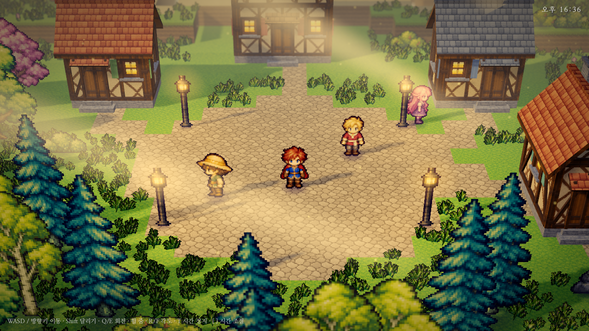

# OwnEngine

[English](README.md) | [한국어](README.ko.md) | **日本語**

> 基準となる文書は[英語版 README](README.md)です。この文書はその翻訳で、内容が異なる場合は英語版に従います。

AI エージェントが人と同じくらい簡単に操作・検証できるように作られた、小さな C++17 ゲームエンジンです。
エディターが行うことはすべて 1 つのレジストリに登録されたコマンドで、同じコマンドを CLI、HTTP、MCP から呼び出せます。
そのため、エージェントと人が同じセッションで同時に作業できます。


| ゲームビュー (`oe render games/RPG --renderer gpu --frames 460`) | |
|---|---|
|  | `games/RPG`、HD-2D の村: 生成したボクセル地形の上のピクセルアートのビルボード、モデリングした家、揺れる草と木、昼夜サイクル、フォグ、ブルーム、カラーグレーディング、被写界深度。ソフトウェアレンダラーは同じシーンをテストとハッシュのために決定的に描画します。 |

## 何が違うのか

- **すべてが 1 つの API。** シーン編集、シミュレーション、入力、スクリーンショット、アセットなど、どの機能も JSON
  スキーマを持つコマンドで、`{"ok":true,"result":..}` または `{"ok":false,"error":{code,message,hint}}` を返します。
  エディターもこのコマンドだけでシーンを変更するので、アンドゥ、エージェント、人がずれることはありません。
- **ウィンドウなしで検証できる。** シミュレーションは固定ステップで決定的であり、ソフトウェアレンダラーは同じシーンと
  入力に対してどのプラットフォームでも同じフレームハッシュを返します。エージェントはゲームを進め、入力を与え、
  スクリーンショットを撮って自分で確認できます。
- **インストール不要。** Windows では Visual Studio 2022 だけが必要です。Lua、Jolt Physics、Box2D、sokol_gfx、stb、
  cgltf、ufbx、Dear ImGui は同梱されており、Web と Android のプレイヤーランタイムは `runtime/` にビルド済みです。
- **エンジンかプロジェクトか。** Lua スクリプトで表現できる挙動は、エンジンのコンポーネントではなくプロジェクト
  (テンプレートとゲーム)に置きます。エンジンにはスクリプトではできないこと、そして 2 つのレンダラーと決定的な
  コアが一致しなければならないものだけを残します。

## クイックスタート

```bat
build.bat                                   :: Release ビルド -> build\bin\oe.exe, build\bin\oe_tests.exe
build\bin\oe_tests.exe                      :: 単体テスト、終了コード 0 = 成功

build\bin\oe.exe new MyGame                 :: プロジェクト作成 (2 レベルのコイン集めゲーム)
build\bin\oe.exe editor MyGame              :: エディター。http://127.0.0.1:7777 で API も提供
build\bin\oe.exe run MyGame                 :: ネイティブウィンドウでプレイ (WASD / Space)
```

Windows では「C++ によるデスクトップ開発」を入れた Visual Studio 2022 が必要です。`build.bat` がそれを見つけ、付属の
CMake と Ninja を使います。最初のビルドは Jolt のコンパイルで数分かかります。Linux では
`cmake -S . -B build -G Ninja` でヘッドレスのツール(CLI、MCP、テスト、EGL があれば GPU スクリーンショット)をビルドします。

## コマンドライン

| コマンド | 内容 |
|---|---|
| `oe new <dir> [--name N]` | `templates/default` からプロジェクトを作成 |
| `oe editor <project> [--lang en\|ko\|ja]` | ネイティブエディター。`--screenshot f.png` はウィンドウなしで画像に描画 |
| `oe run <project>` | ウィンドウでプレイ |
| `oe render <project> --out shot.png [--frames 60] [--renderer gpu]` | シミュレーション後にスクリーンショットを保存 |
| `oe exec <project> <command> [json] [--save]` | コマンドを 1 つ実行し JSON を出力 |
| `oe script <project> [--save]` | 標準入力の `{"command":..,"args":..}` 行を実行 |
| `oe mcp <project> [--port 7777]` / `oe mcp --connect 7777` | stdio の MCP サーバー / 実行中のエディターに接続 |
| `oe import <project> <file>` | モデル、テクスチャ、サウンド、フォントをプロジェクトにコピー |
| `oe package <project> [--web\|--android]` | 単体ゲーム: `Name.exe` + `game.pak` (圧縮・ゲーム別キーで暗号化、スクリプトはストリップ済みバイトコード。[PACKAGING](docs/PACKAGING.md))、静的 Web フォルダー、署名済み APK / App Bundle |
| `oe serve <dir>` / `oe serve-game <project>` | Web ビルドのローカルサーバー / ヘッドレス専用サーバー |
| `oe api --markdown` | コマンドリファレンスを出力 ([docs/API.md](docs/API.md)) |

```bat
oe exec MyGame scene.summary
oe exec MyGame entity.create "{\"name\":\"Box\",\"components\":{\"MeshRenderer\":{\"color\":\"#ff8800\"}}}" --save
oe render MyGame --frames 120 --out shot.png
```

## AI エージェントと使う

| 方法 | 使い方 |
|---|---|
| MCP (Claude Code など) | `oe mcp <project>`: すべてのコマンドがツールになり、スクリーンショットは画像で返ります。エンジンをビルドすれば [.mcp.json](.mcp.json) が `games/RPG` を接続します |
| 人が開いたエディターに接続 | `oe mcp --connect 7777`、MCP なしなら `oe exec --connect 7777 <command> [json]` と `oe script --connect 7777`。編集はエディターにすぐ表示されます |
| CLI とスクリプト | `oe exec`、`oe script` (JSON の入出力、失敗時は終了コード 1) |
| HTTP | `POST http://127.0.0.1:7777/api/call`、本文 `{"command": "...", "args": {...}}` |

エージェント向けの作業ガイドは [AGENTS.md](AGENTS.md)([CLAUDE.md](CLAUDE.md) と同じ内容)、すべての貢献者が従う
ルールは [docs/DESIGN.md](docs/DESIGN.md) にあります。

**エージェントチーム。** エディター内で複数のエージェントをチームとして置き、チャットパネルで仕事を任せられます
(`@名前`、`@all`、エージェント間の引き継ぎ)。エンジンはモデル API を直接呼ばず、PC にインストールされたコーディング
エージェント CLI (Claude Code、Codex) を子プロセスとして実行します。Windows のみ、開発中 —
[docs/TEAM.md](docs/TEAM.md)。

エージェント使用量: `team.usage`でエージェント/日別トークンとターン別費用を取得できます。Teamパネルは本日(UTC)の使用量を表示し、Claudeプロファイルに`maxBudgetUsd`を設定できます（0で無制限）。

タスク委譲はチャットと併用できます。`team.delegate/report/task/tasks`で新しいワーカー会話、期限、証拠報告を扱います。`canCall`の既定は呼出先なしで、リーダーは全員を呼べます。ツール報告なしの正常終了はdoneですが未検証です。

`team.reset {id}`（または一覧のReset Conversation）で待機中のエージェント一人の会話を初期化できます。チャットと使用量は保持します。`team.settings {rotateAboveInputTokens: N}`は入力サイズが閾値に達すると次のターンを新しい会話で開始します。既定値0は無効です。初期化でキャッシュの節約効果を失う場合があります。

## エディター

`oe editor` はドッキングエディター(Dear ImGui + ImGuizmo、エンジンプロセス内で GPU 描画)を開きます。Hierarchy、
リフレクションから生成される Inspector、移動/回転/拡縮ギズモとタイルブラシ付き 2D ビューを持つ Scene ビュー、
キーボードとマウスをゲームに渡す Game ビュー、サムネイルとドラッグ&ドロップ取り込みのある Assets、エラーをその場で
示す Lua コードエディター、コマンドライン付き Console、History、Network、Team パネルがあります。1 回のドラッグが
アンドゥ 1 段階で、プレハブは隔離して編集でき、インターフェースは英語、韓国語、日本語に対応します。
Assets はグリッド/リスト表示、名前・パス検索、件数付きの種類フィルターに対応します。高さの低いパネルは名前が見えるコンパクトな行表示になります。
17 px の文字、明確な選択・フォーカス表示、パネル幅に合わせた X/Y/Z フィールド、重要度ラベルと折り返すフィルター付き Console を提供します。表示 > インターフェースサイズで倍率を調整できます。
詳細とショートカット: [docs/EDITOR.md](docs/EDITOR.md)。

スクリプトタブの右クリックで閉じる・他を閉じる・すべて閉じるを選べ、未保存の変更は確認してから処理します。入力中に Lua API とファイル内の名前を補完候補として表示します(Ctrl+Space: 候補、Tab/Enter: 挿入)。
シェーダーグラフでノード接続・ユニフォーム編集・表面プレビューを行い、シェーダーを使うマテリアルの作成と選択メッシュへの適用ができます。アセットのシェーダー・マテリアル、または表示 > シェーダーグラフから開きます([ガイド](docs/SHADER_EDITOR.md))。

## 機能

| 分野 | 内容 | ドキュメント |
|---|---|---|
| レンダリング | 1 つのシーンを描く 2 つのレンダラー: GPU (sokol_gfx: D3D11、WebGL2、GLES3、MSAA、フィルター付き影) と決定的なマルチスレッドのソフトウェアレンダラー。glTF / FBX モデル、PBR マテリアル、透過、点光源、スポットライトと平行光源、カスケードシャドウとローカルライトの影 | [RENDERING](docs/RENDERING.md) |
| ポストプロセスとシェーダー | 露出と Reinhard/ACES トーンマッピング、ブルーム、ビネット、FXAA、環境光 SSAO、probe/sky フォールバック付きの光沢面のスクリーンスペース反射、被写界深度、距離フォグ、カラーグレーディング。色、発光、頂点オフセット、法線を出力できるサーフェスシェーダーグラフ (`.shader.json`)、スプライトにも適用可能 | [POSTPROCESS](docs/POSTPROCESS.md) |
| 平面反射 | 平面メッシュに動くシーンを映す鏡・水面。ビューごとに一つの反射面、両レンダラー共通のクリッピング | [PLANAR_REFLECTION](docs/PLANAR_REFLECTION.md) |
| ボックスデカール | 汚れ・着弾跡・床のマークを投影。順序付きベースカラー合成、ボックス・法線フェード、ビューごとに16個 | [DECALS](docs/DECALS.md) |
| パーティクル衝突 | 静的な3D/2Dコライダーで停止・反射・消滅。固定ステップの中心軌道検査、生成時の反発・摩擦設定、death chain | [PARTICLE_COLLISION](docs/PARTICLE_COLLISION.md) |
| アニメーション | 両レンダラーで動く glTF / FBX スケルタルアニメーション (描画ごとに64ジョイント)、`Animator`、Lua 再生；スプライト・モデル共通のタイムラインイベントと `onAnimationEvent`、作成・照会コマンド；公式 `oe.animator` のスプライト/モデルコントローラー、型付きパラメーター・順序付き遷移・モデルブレンドを備えた 独立した `.controller.json` グラフ画面と専用の元に戻す・やり直し・保存、実行中の状態・遷移・パラメーター表示；共有 `.anim.json` シート・矩形atlas clips、モデルsidecar表示名・ループ範囲、`animation.create/get/set`とhot reload；スプライトフレームの選択・並べ替え・フレーム時間・ループ編集；独立プレビュー・目盛りスクラブ・キー操作・名前付きイベント編集・プロパティのキーフレームトラック（エンティティと子の位置・回転・スケール・色など）のAnimationパネル（IKは初期状態で除外） | [ANIMATION](docs/ANIMATION.md) |
| パーティクル | 発生形状、寿命カーブ、フリップブック、乱流、速度方向への整列を持つ決定的なエミッター。`Trail` リボン | [PARTICLES](docs/PARTICLES.md) |
| VFX 制作 | 再利用可能な `.vfx.json` と VFXSystem、名前付きパラメータ、Lua 制御、ホットリロード、総粒子予算。モジュール別フィールド、カーブ／グラデーション、独立再生、文書 undo と参照ノードグラフを備える Effects パネル。剣撃と6種類の式エフェクトを含む15種類のプリセット、パーティクルマテリアル／メッシュのバッチ化、二点リボンと深度制限付き子エミッター、検証とプレビュー／分析用の `vfx.*` コマンド 軸別の移動・回転・スケールカーブ、基点ピボットと4つのcustom属性で氷柱の成長などをVFX内で制御。 | [VFX](docs/VFX.md) |
| ナビゲーション | 静的なコライダーやモデルからベイクするナビゲーションメッシュ (Recast/Detour): 経路、最近点、歩行レイキャスト、Lua エージェント | [NAVIGATION](docs/NAVIGATION.md) |
| 物理 | Jolt による 3D と Box2D による 2D: 剛体、トリガー、キャラクターコントローラー、一方通行の足場、衝突レイヤー、レイキャスト。決定的 | [PHYSICS](docs/PHYSICS.md) |
| 2D | スプライトとシートアニメーション、タイルセットファイルを使うテキストタイルマップ、オートタイルとタイルごとの衝突、スプライトエディター（プレビュー付きシート分割、フレームごとの衝突輪郭）、2D ライト、3D 世界の HD-2D スプライト | [2D](docs/2D.md) |
| UI | テキスト (TrueType、リッチテキスト、自動縮小)、パネル、ボタン (トグル、ラジオグループ、アイコン)、画像、スライダー、テキスト入力、ドロップダウン、画面上のジョイスティック、レイアウト、スクロールビュー、登場モーション、キーボード/ゲームパッドのフォーカス。どの要素も色の代わりに 9-slice 画像を使えます | [UI](docs/UI.md) |
| ゲームプレイ | プレハブ、シーン切り替えとゲームデータ、メッセージとタイマー、ポーズ、日付、オーディオ (決定的な 48 kHz ミキサー、効果音生成)、広告と課金のためのホストブリッジ | [GAMEPLAY](docs/GAMEPLAY.md) |
| スクリプト | プレイセッションごとにサンドボックス化された Lua 5.4、ホットリロード、ファイルと行番号付きのエラー、静的チェック、トゥイーン | [SCRIPTING](docs/SCRIPTING.md) |
| 入力 | キーボード、マウス、マルチタッチ、ゲームパッド (6 軸、共通デッドゾーン)。すべて API から注入可能 | [INPUT](docs/INPUT.md), [TOUCH](docs/TOUCH.md) |
| セーブ | `save.get/set/delete/flush` のスロット。ツールセッションは `--save-dir` がなければメモリのみ | [SAVE](docs/SAVE.md) |
| ネットワーク | オプトイン: ロビーと RPC、ロックステップ、ロールバック、予測と補間を備えた権威サーバー複製。UDP、TCP、WebSocket。専用サーバー | [NETWORK](docs/NETWORK.md) |

## プラットフォーム

| プラットフォーム | 状態 | 備考 |
|---|---|---|
| Windows (x64) | 動作 | ネイティブウィンドウ、Direct3D 11、エディター、`oe package` → `Name.exe` |
| Web (WebAssembly) | 動作 | WebGL2。`runtime/web/` にランタイムがあるので `oe package --web` に Emscripten は不要 |
| Android | エミュレーターで動作、実機での確認は未了 | `oe` が APK / App Bundle を直接書き出して署名 (Gradle なし) — [docs/ANDROID.md](docs/ANDROID.md) |
| Linux、ヘッドレス | 動作 | `null` プラットフォーム: CLI、MCP、テスト、スクリーンショット |
| macOS、iOS | 計画中 | [docs/APPLE.md](docs/APPLE.md) |
| Linux デスクトップ、コンソール | 計画中 | [docs/PLATFORMS.md](docs/PLATFORMS.md) |

プレイヤーが使うエンジンの C++ を変更したら、ランタイムを再ビルドします: `build_web.bat` (Emscripten SDK が必要、
`set EMSDK=...`) と `build_android.bat` (Android NDK が必要)。その後 `runtime/` をコミットします。

## サンプルゲーム

| プロジェクト | 見どころ |
|---|---|
| `games/RPG` | three.js のプロトタイプを移植した HD-2D の村: 生成したボクセル地形、モデリングした木骨造の家、ビルボード、揺れる草と木、空・雲・月・山、水、パーティクル、昼夜サイクル、周回カメラ。すべての絵は画像生成で作りました。設計メモ: [docs/RPG.md](docs/RPG.md) |

`oe run games/RPG` で実行するか、`oe editor games/RPG` で開きます。`oe new <dir>` は `templates/default` から
小さな最初のゲームを作ります。

## リポジトリ構成

```
engine/core       Json, Math, Log, PNG, FileSystem, Zip
engine/scene      リフレクション、コンポーネント、Scene、挙動システム
engine/script     Lua スクリプトホストと静的チェック
engine/physics    Jolt (PhysicsWorld) と Box2D (Physics2D) のラッパー
engine/nav        ナビゲーションメッシュ (Recast/Detour): シーンからのベイク、経路クエリ
engine/audio      ミキサー、WAV、効果音ジェネレーター
engine/net        トランスポート、チャンネル、セッション、ロックステップ/ロールバック、権威サーバー
engine/assets     アセットキャッシュ、glTF、FBX と画像の読み込み
engine/render     IRenderer、ソフトウェア/GPU レンダラー、シェーダー、マテリアル、UI、フォント
engine/api        コマンドレジストリ、HTTP サーバー、MCP サーバー
engine/app        Engine (シミュレーション、アンドゥ、ジョブ)、パッケージング、専用サーバー
engine/editor     ネイティブエディター (ゲームにはリンクされない)
engine/team       エージェントチーム (ゲームにはリンクされない)
engine/platform   Platform.h + win32、web、android、null の実装
tools/oe          CLI          tools/player   ゲームランタイム          tools/shaders  シェーダー再生成
tests/            セルフテスト (WebAssembly でも実行)
templates/        `oe new` がコピーするもの          games/   サンプルゲーム
runtime/          ビルド済みの Web と Android プレイヤーランタイム
third_party/      Lua 5.4.8, Jolt 5.6.0, Box2D 3.1.1, Recast/Detour 1.6.0, sokol, stb, cgltf, ufbx, Dear ImGui, ImGuizmo, ImGuiColorTextEdit, Roboto
```

より詳しいコードマップは [AGENTS.md](AGENTS.md)、構造図は [docs/ARCHITECTURE.md](docs/ARCHITECTURE.md) にあります。

## ドキュメント

| 文書 | 用途 |
|---|---|
| [AGENTS.md](AGENTS.md) / [CLAUDE.md](CLAUDE.md) | ビルド、エンジンの操作、コードマップ、規約 (人もエージェントもここから) |
| [docs/DESIGN.md](docs/DESIGN.md) | 不変条件、コードの置き場所、コードスタイル、完了の定義、セッション間の引き継ぎ |
| [docs/ARCHITECTURE.md](docs/ARCHITECTURE.md) | レイヤーの構成 |
| [docs/API.md](docs/API.md) | すべてのコマンドとコンポーネント。`oe api --markdown` で生成 |
| 機能ドキュメント | [機能](#機能) の表を参照。機能の説明と使い方から始まり、末尾に未解決の項目があります |
| [docs/PLATFORMS.md](docs/PLATFORMS.md), [docs/ANDROID.md](docs/ANDROID.md), [docs/APPLE.md](docs/APPLE.md) | プラットフォームの状態と移植 |
| [docs/ROADMAP.md](docs/ROADMAP.md) | 機能ロードマップと優先順位付きのタスク一覧 |
| [docs/NETWORK_NOTES.md](docs/NETWORK_NOTES.md), [docs/TEAM_LOG.md](docs/TEAM_LOG.md) | 機能ドキュメントから分けた作業ログと実装ノート |

ドキュメントは英語で書かれています。この README だけを[英語](README.md)、[韓国語](README.ko.md)、日本語で維持しています。

## コントリビュート

まず [docs/DESIGN.md](docs/DESIGN.md) を読んでください。要点: どの機能もコマンド、`tests/tests.cpp` のテスト、
ドキュメントと一緒に入れます。シミュレーションは決定的に保ち、ライティングの変更は両方のレンダラーに入れ、新しい依存は
追加せず、何を検証し何を検証していないかを報告します。

## ライセンス

MIT — [LICENSE](LICENSE)。`third_party/` のコードはそれぞれのライセンスに従います (MIT、zlib、パブリックドメイン、
Roboto フォントは Apache 2.0)。
