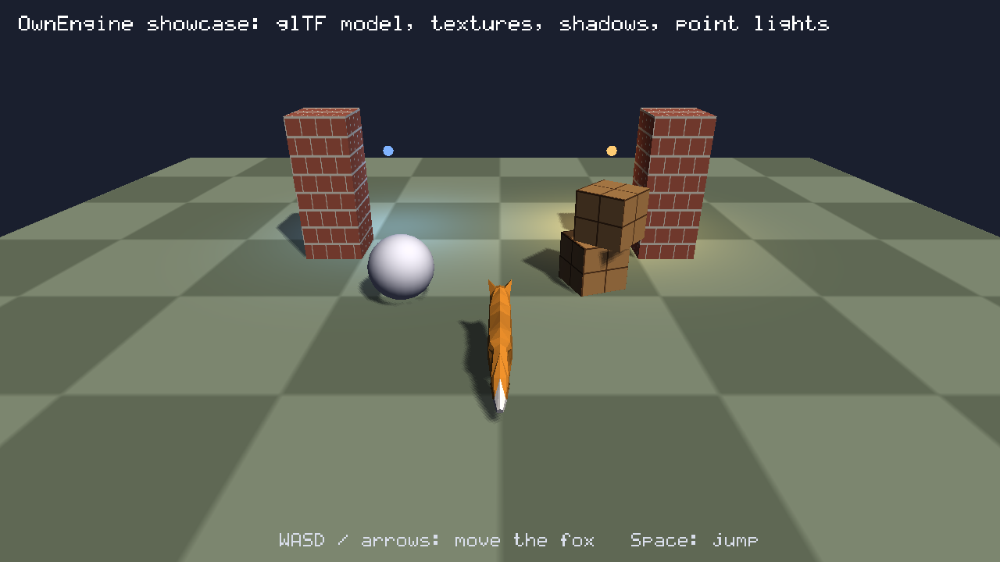

# OwnEngine

[English](README.md) | **한국어** | [日本語](README.ja.md)

> 기준 문서는 [영문 README](README.md)입니다. 이 문서는 그 번역이며, 내용이 다르면 영문을 따릅니다.

AI 에이전트가 사람만큼 쉽게 조작하고 검증할 수 있도록 만든 작은 C++17 게임 엔진입니다.
에디터가 하는 모든 일은 하나의 레지스트리에 등록된 명령이고, 같은 명령을 CLI, HTTP, MCP로 호출할 수 있습니다.
그래서 에이전트와 사람이 같은 세션에서 동시에 작업할 수 있습니다.


| 게임 뷰 (`oe render samples/Showcase`) | |
|---|---|
|  | glTF 여우(플레이어 조작, 추적 카메라), 절차적 텍스처, 그림자, 점광원. 결정적인 소프트웨어 렌더러의 출력입니다. 게임 창, 웹 빌드, 에디터 뷰는 같은 장면을 GPU 렌더러로 그립니다. |

## 무엇이 다른가

- **모든 것이 하나의 API.** 씬 편집, 시뮬레이션, 입력, 스크린샷, 에셋 등 모든 기능이 JSON 스키마를 가진 명령이며
  `{"ok":true,"result":..}` 또는 `{"ok":false,"error":{code,message,hint}}`로 답합니다. 에디터도 이 명령으로만
  씬을 바꾸므로 실행 취소, 에이전트, 사람이 어긋나지 않습니다.
- **창 없이 검증 가능.** 시뮬레이션은 고정 스텝이고 결정적이며, 소프트웨어 렌더러는 같은 씬과 입력에 대해 모든
  플랫폼에서 같은 프레임 해시를 냅니다. 에이전트가 게임을 진행시키고, 입력을 넣고, 스크린샷을 찍어 직접 확인합니다.
- **설치할 것이 없음.** Windows에서는 Visual Studio 2022만 있으면 됩니다. Lua, Jolt Physics, Box2D, sokol_gfx,
  stb, cgltf, Dear ImGui가 저장소에 포함되어 있고, 웹과 Android 플레이어 런타임은 `runtime/`에 미리 빌드되어 있습니다.
- **엔진이냐 프로젝트냐.** Lua 스크립트로 표현할 수 있는 동작은 엔진 컴포넌트가 아니라 프로젝트(템플릿, 샘플)에
  둡니다. 엔진에는 스크립트가 할 수 없는 것과 두 렌더러 및 결정적 코어가 일치해야 하는 것만 남깁니다.

## 빠른 시작

```bat
build.bat                                   :: Release 빌드 -> build\bin\oe.exe, build\bin\oe_tests.exe
build\bin\oe_tests.exe                      :: 단위 테스트, 종료 코드 0 = 통과

build\bin\oe.exe new MyGame                 :: 프로젝트 생성 (두 레벨짜리 코인 수집 게임)
build\bin\oe.exe editor MyGame              :: 에디터, http://127.0.0.1:7777 에서 API도 제공
build\bin\oe.exe run MyGame                 :: 네이티브 창에서 플레이 (WASD / Space)
```

Windows에서는 "C++를 사용한 데스크톱 개발"이 설치된 Visual Studio 2022가 필요합니다. `build.bat`이 이를 찾아 내장
CMake와 Ninja를 씁니다. 첫 빌드는 Jolt를 컴파일하느라 몇 분 걸립니다. Linux에서는 `cmake -S . -B build -G Ninja`로
헤드리스 도구(CLI, MCP, 테스트, EGL이 있으면 GPU 스크린샷)를 빌드합니다.

## 명령줄

| 명령 | 하는 일 |
|---|---|
| `oe new <dir> [--name N]` | `templates/default`로 프로젝트 생성 |
| `oe editor <project> [--lang en\|ko\|ja]` | 네이티브 에디터. `--screenshot f.png`는 창 없이 에디터를 이미지로 렌더 |
| `oe run <project>` | 창에서 플레이 |
| `oe render <project> --out shot.png [--frames 60] [--renderer gpu]` | 시뮬레이션 후 스크린샷 저장 |
| `oe exec <project> <command> [json] [--save]` | 명령 하나 실행, JSON 출력 |
| `oe script <project> [--save]` | 표준 입력의 `{"command":..,"args":..}` 줄들을 실행 |
| `oe mcp <project> [--port 7777]` / `oe mcp --connect 7777` | stdio MCP 서버 / 실행 중인 에디터에 연결 |
| `oe import <project> <file>` | 모델, 텍스처, 사운드, 폰트를 프로젝트로 복사 |
| `oe package <project> [--web\|--android]` | 독립 실행 게임: `Name.exe` + 데이터, 정적 웹 폴더, 서명된 APK / App Bundle |
| `oe serve <dir>` / `oe serve-game <project>` | 웹 빌드 로컬 서버 / 헤드리스 전용 서버 |
| `oe api --markdown` | 명령 레퍼런스 출력 ([docs/API.md](docs/API.md)) |

```bat
oe exec MyGame scene.summary
oe exec MyGame entity.create "{\"name\":\"Box\",\"components\":{\"MeshRenderer\":{\"color\":\"#ff8800\"}}}" --save
oe render MyGame --frames 120 --out shot.png
```

## AI 에이전트와 함께 쓰기

| 방법 | 사용법 |
|---|---|
| MCP (Claude Code 등) | `oe mcp <project>`: 모든 명령이 도구가 되고 스크린샷은 이미지로 돌아옵니다. 엔진을 빌드하면 [.mcp.json](.mcp.json)이 `samples/Hello`를 연결합니다 |
| 사람이 연 에디터에 연결 | `oe mcp --connect 7777`, MCP 없이는 `oe exec --connect 7777 <command> [json]`, `oe script --connect 7777`. 편집 내용이 에디터에 바로 보입니다 |
| CLI와 스크립트 | `oe exec`, `oe script` (JSON 입출력, 실패 시 종료 코드 1) |
| HTTP | `POST http://127.0.0.1:7777/api/call`, 본문 `{"command": "...", "args": {...}}` |

에이전트용 작업 가이드는 [AGENTS.md](AGENTS.md)([CLAUDE.md](CLAUDE.md)와 같은 내용)이고, 모든 기여자가 따르는 규칙은
[docs/DESIGN.md](docs/DESIGN.md)에 있습니다.

**에이전트 팀.** 에디터 안에서 여러 에이전트를 팀으로 두고 채팅 패널에서 일을 시킬 수 있습니다(`@이름`, `@all`,
에이전트 간 인계). 엔진이 모델 API를 직접 부르지 않고, PC에 설치된 코딩 에이전트 CLI(Claude Code, Codex)를 자식
프로세스로 실행합니다. Windows 전용, 진행 중 — [docs/TEAM.md](docs/TEAM.md).

에이전트 사용량: `team.usage`로 에이전트/날짜별 토큰과 턴별 비용을 읽습니다. Team 패널은 오늘(UTC)의 사용량을 표시하며, Claude 프로필에 `maxBudgetUsd`를 설정할 수 있습니다(0은 제한 해제).

작업 위임은 채팅과 병행합니다. `team.delegate/report/task/tasks`는 새 워커 대화, 제한 시간, 증거 보고를 제공합니다. `canCall` 기본값은 호출 대상 없음이며 리더는 모두 호출할 수 있습니다. 도구 보고 없이 정상 종료한 워커는 done이지만 검증되지 않았습니다.

`team.reset {id}`(또는 목록의 Reset Conversation)로 유휴 에이전트 한 명의 대화를 초기화합니다. 채팅과 사용량은 보존됩니다. `team.settings {rotateAboveInputTokens: N}`은 입력 크기가 임계값에 도달하면 다음 턴을 새 대화로 시작합니다. 기본값 0은 해제이며, 초기화로 캐시 절약 효과가 사라질 수 있습니다.

## 에디터

`oe editor`는 도킹 에디터(Dear ImGui + ImGuizmo, 엔진 프로세스 안에서 GPU로 그림)를 엽니다. Hierarchy, 리플렉션으로
생성되는 Inspector, 이동/회전/크기 기즈모와 타일 브러시가 있는 2D 뷰를 가진 Scene 뷰, 키보드와 마우스를 게임에
넘기는 Game 뷰, 썸네일과 드래그 앤 드롭 임포트가 되는 Assets, 실시간 오류 표시가 있는 Lua 코드 에디터, 명령줄이
있는 Console, History, Network, Team 패널이 있습니다. 드래그 한 번이 실행 취소 한 단계이고, 프리팹은 격리해서
편집하며, 인터페이스는 영어, 한국어, 일본어를 지원합니다. 자세한 내용과 단축키: [docs/EDITOR.md](docs/EDITOR.md).

Assets는 격자/목록 전환, 이름·경로 검색, 개수가 표시되는 종류 필터를 지원합니다. 낮은 패널은 이름이 보이도록 간결한 목록으로 표시됩니다.
인터페이스는 17px 글자, 선명한 선택·포커스 표시, 패널 너비에 맞춰 배치되는 X/Y/Z 필드, 심각도 이름과 줄바꿈 필터가 있는 Console을 제공합니다. 보기 > 인터페이스 크기에서 배율을 조절합니다.

스크립트 탭 우클릭으로 닫기·다른 탭 닫기·전체 닫기를 선택하며, 미저장 변경은 확인 후 처리합니다. 입력 중 Lua API와 파일 내 이름을 자동완성으로 제안합니다(Ctrl+Space: 목록, Tab/Enter: 삽입).
셰이더 그래프에서 노드 연결·유니폼 편집·표면 미리보기를 제공하며, 셰이더에 연결된 머티리얼을 생성해 선택한 메시에 적용합니다. 에셋의 셰이더·머티리얼을 열거나 보기 > 셰이더 그래프를 선택하세요([안내](docs/SHADER_EDITOR.md)).


## 기능

| 영역 | 내용 | 문서 |
|---|---|---|
| 렌더링 | 하나의 씬을 그리는 두 렌더러: GPU(sokol_gfx: D3D11, WebGL2, GLES3, MSAA, 필터링된 그림자)와 결정적인 멀티스레드 소프트웨어 렌더러. glTF 모델, PBR 머티리얼, 투명, 점광원/방향광, 그림자 | [RENDERING](docs/RENDERING.md) |
| 포스트 프로세싱과 셰이더 | 노출과 톤 매핑, 블룸, 비네트, FXAA, 피사계 심도. 색, 발광, 정점 오프셋, 노멀 출력을 가진 표면 셰이더 그래프(`.shader.json`) | [POSTPROCESS](docs/POSTPROCESS.md), [TOON](docs/TOON.md) |
| 애니메이션 | 두 렌더러에서 동작하는 glTF 스켈레탈 애니메이션(관절 64개까지), `Animator`, Lua 재생 | [ANIMATION](docs/ANIMATION.md) |
| 파티클 | 생성 모양, 수명 곡선, 플립북, 난류, 속도 정렬을 가진 결정적 이미터. `Trail` 리본 | [PARTICLES](docs/PARTICLES.md) |
| VFX 제작 | 재사용 `.vfx.json` 에셋과 VFXSystem, 이름 기반 파라미터, Lua 제어, hot reload, 전체 입자 예산. 모듈별 필드·곡선·그라디언트·독립 재생·문서 undo를 지원하는 Effects 패널. 8개 프리셋과 검사·미리보기·분석용 `vfx.*` 명령 | [VFX](docs/VFX.md) |
| 물리 | Jolt 3D와 Box2D 2D: 강체, 트리거, 캐릭터 컨트롤러, 일방통행 플랫폼, 충돌 레이어, 레이캐스트. 결정적 | [PHYSICS](docs/PHYSICS.md) |
| 2D | 스프라이트와 시트 애니메이션, 타일셋 파일을 쓰는 텍스트 타일맵, 오토타일과 타일별 충돌, 2D 조명, 3D 세계 속 HD-2D 스프라이트 | [2D](docs/2D.md) |
| UI | 텍스트(TrueType, 리치 텍스트, 자동 축소), 패널, 버튼(토글, 라디오 그룹, 아이콘), 이미지, 슬라이더, 텍스트 입력, 드롭다운, 화면 조이스틱, 레이아웃, 스크롤 뷰, 등장 모션, 키보드/게임패드 포커스. 모든 요소에 색 대신 9-slice 이미지 사용 가능 | [UI](docs/UI.md) |
| 게임플레이 | 프리팹, 씬 전환과 게임 데이터, 메시지와 타이머, 일시정지, 날짜, 오디오(결정적 48 kHz 믹서, 효과음 생성), 광고와 결제용 호스트 브리지 | [GAMEPLAY](docs/GAMEPLAY.md) |
| 스크립팅 | 플레이 세션마다 샌드박스된 Lua 5.4, 핫 리로드, 파일과 줄 번호가 있는 오류, 정적 검사, 트윈 | [SCRIPTING](docs/SCRIPTING.md) |
| 입력 | 키보드, 마우스, 멀티 터치, 게임패드(6축, 공통 데드존). 모두 API로 주입 가능 | [INPUT](docs/INPUT.md), [TOUCH](docs/TOUCH.md) |
| 세이브 | `save.get/set/delete/flush` 슬롯. 도구 세션은 `--save-dir`가 없으면 메모리에만 저장 | [SAVE](docs/SAVE.md) |
| 네트워킹 | 선택 사항: 로비와 RPC, 락스텝, 롤백, 예측과 보간을 가진 권위 서버 복제. UDP, TCP, WebSocket. 전용 서버 | [NETWORK](docs/NETWORK.md), [NETWORK_SAMPLES](docs/NETWORK_SAMPLES.md) |

## 플랫폼

| 플랫폼 | 상태 | 비고 |
|---|---|---|
| Windows (x64) | 동작 | 네이티브 창, Direct3D 11, 에디터, `oe package` → `Name.exe` |
| 웹 (WebAssembly) | 동작 | WebGL2. `runtime/web/`에 런타임이 있어 `oe package --web`에 Emscripten 불필요 |
| Android | 에뮬레이터에서 동작, 실제 기기 확인 남음 | `oe`가 APK / App Bundle을 직접 쓰고 서명 (Gradle 없음) — [docs/ANDROID.md](docs/ANDROID.md) |
| Linux, 헤드리스 | 동작 | `null` 플랫폼: CLI, MCP, 테스트, 스크린샷 |
| macOS, iOS | 계획 | [docs/APPLE.md](docs/APPLE.md) |
| Linux 데스크톱, 콘솔 | 계획 | [docs/PLATFORMS.md](docs/PLATFORMS.md) |

플레이어가 쓰는 엔진 C++를 바꾼 뒤에는 런타임을 다시 빌드합니다: `build_web.bat`(Emscripten SDK 필요,
`set EMSDK=...`)과 `build_android.bat`(Android NDK 필요). 그 뒤 `runtime/`을 커밋합니다.

## 샘플과 게임

`oe run <경로>`로 실행하거나 `oe editor <경로>`로 엽니다.

| 프로젝트 | 보여주는 것 |
|---|---|
| `samples/Hello` | `oe new` 템플릿: 두 레벨짜리 코인 게임 |
| `samples/Showcase` | 렌더링: 애니메이션되는 glTF 여우, 그림자, 점광원, 포스트 프로세싱 프리셋 |
| `samples/Platformer`, `samples/Dungeon` | Box2D 기반 2D 횡스크롤과 탑다운 액션: 타일맵, 오토타일, 스프라이트 애니메이션 |
| `samples/Wickbound` | 완성된 10분짜리 서바이버 로그라이트: 스크립트가 붙은 프리팹, 2D 조명, 메뉴와 대화상자, 세이브 |
| `samples/FPS` | 1인칭 슈터: 마우스 룩, 히트스캔, 움직이는 표적 |
| `samples/HD2D`, `samples/Water` | 피사계 심도가 있는 3D 세계의 픽셀 아트 스프라이트, 셰이더 그래프로 만든 바다 |
| `samples/ShaderLab`, `samples/WuwaToon`, `samples/VFXLab` | 표면 셰이더 그래프, 툰 셰이딩 연구, 파티클과 트레일 이펙트 |
| `samples/NetCoop`, `NetDuel`, `NetArena`, `NetChase` | 락스텝 협동, 롤백 대전, 권위 서버 아레나와 3인칭 레이스. 게임 내 로비 포함 |
| `games/OnlineRPG` | HD-2D 그래픽의 온라인 RPG 프로토타입(로그인 서버 + 언제든 입장 가능한 채널 서버): 바닥 아이템, 줍기, 가방, 버리기, 채팅과 말풍선 — 설계 문서: [docs/ONLINERPG.md](docs/ONLINERPG.md) |
| `games/DongleZoo` | 출시 가능한 세로형 모바일 머지 퍼즐: 상점, 미션, 호스트 브리지를 통한 광고와 결제 — 설계 문서: [docs/DONGLEZOO.md](docs/DONGLEZOO.md) |

## 저장소 구조

```
engine/core       Json, Math, Log, PNG, FileSystem, Zip
engine/scene      리플렉션, 컴포넌트, Scene, 동작 시스템
engine/script     Lua 스크립트 호스트와 정적 검사
engine/physics    Jolt(PhysicsWorld), Box2D(Physics2D) 래퍼
engine/audio      믹서, WAV, 효과음 생성기
engine/net        트랜스포트, 채널, 세션, 락스텝/롤백, 권위 서버
engine/assets     에셋 캐시, glTF와 이미지 로딩
engine/render     IRenderer, 소프트웨어/GPU 렌더러, 셰이더, 머티리얼, UI, 폰트
engine/api        명령 레지스트리, HTTP 서버, MCP 서버
engine/app        Engine(시뮬레이션, 실행 취소, 작업 큐), 패키징, 전용 서버
engine/editor     네이티브 에디터 (게임에 링크되지 않음)
engine/team       에이전트 팀 (게임에 링크되지 않음)
engine/platform   Platform.h + win32, web, android, null 구현
tools/oe          CLI          tools/player   게임 런타임          tools/shaders  셰이더 재생성
tests/            자체 테스트 (WebAssembly로도 실행)
templates/        `oe new`가 복사하는 것          samples/, games/   위 표 참고
runtime/          미리 빌드된 웹, Android 플레이어 런타임
third_party/      Lua 5.4.8, Jolt 5.6.0, Box2D 3.1.1, sokol, stb, cgltf, Dear ImGui, ImGuizmo, ImGuiColorTextEdit, Roboto
```

더 자세한 코드 지도는 [AGENTS.md](AGENTS.md), 구조 그림은 [docs/ARCHITECTURE.md](docs/ARCHITECTURE.md)에 있습니다.

## 문서

| 문서 | 용도 |
|---|---|
| [AGENTS.md](AGENTS.md) / [CLAUDE.md](CLAUDE.md) | 빌드, 엔진 조작법, 코드 지도, 규약 (사람이든 에이전트든 여기서 시작) |
| [docs/DESIGN.md](docs/DESIGN.md) | 불변 조건, 코드 위치, 코드 스타일, 완료의 정의, 세션 간 인계 |
| [docs/ARCHITECTURE.md](docs/ARCHITECTURE.md) | 계층 구조 |
| [docs/API.md](docs/API.md) | 모든 명령과 컴포넌트. `oe api --markdown`으로 생성 |
| 기능 문서 | [기능](#기능) 표 참고. 기능 설명과 사용법으로 시작하고, 끝에 완료/미검증 항목을 적은 작업 로그가 있음 |
| [docs/PLATFORMS.md](docs/PLATFORMS.md), [docs/ANDROID.md](docs/ANDROID.md), [docs/APPLE.md](docs/APPLE.md) | 플랫폼 상태와 포팅 |
| [docs/ROADMAP.md](docs/ROADMAP.md) | 기능 로드맵과 우선순위 작업 목록 |
| [docs/NETWORK_NOTES.md](docs/NETWORK_NOTES.md), [docs/TEAM_LOG.md](docs/TEAM_LOG.md) | 기능 문서에서 분리한 작업 로그와 구현 노트 |

문서는 영어로 작성합니다. 이 README만 [영어](README.md), 한국어, [일본어](README.ja.md)로 유지합니다.

## 기여

먼저 [docs/DESIGN.md](docs/DESIGN.md)를 읽으세요. 요약: 모든 기능은 명령, `tests/tests.cpp`의 테스트, 문서와 함께
들어갑니다. 시뮬레이션은 결정적으로 유지하고, 조명 변경은 두 렌더러에 모두 적용하며, 새 의존성은 추가하지 않고,
무엇을 검증했고 무엇을 못 했는지 함께 보고합니다.

## 라이선스

MIT — [LICENSE](LICENSE). `third_party/`의 코드는 각자의 라이선스를 따릅니다(MIT, zlib, 퍼블릭 도메인, Roboto 폰트는
Apache 2.0).
