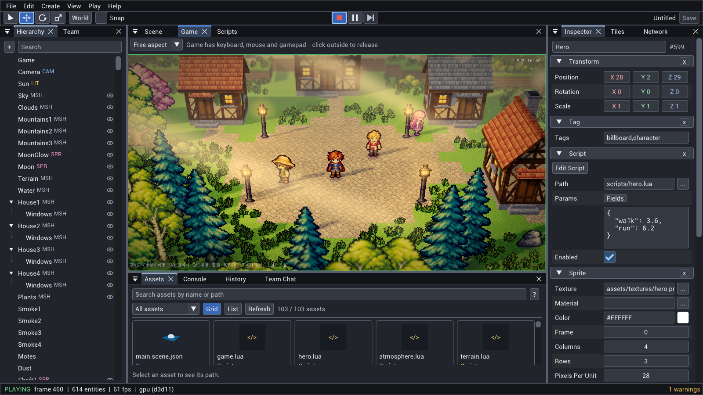

# Editor

`oe editor <project>` opens the native editor: a Dear ImGui docking application drawn on the GPU in the engine
process. It changes the scene only through commands, so an agent attached with `oe mcp --connect 7777` works in
the same session as the person. Open items are listed under [Status](#status) at the end.

## Overview

The Camera Inspector exposes `PostProcess.ssr`, `ssrDistance` and `ssrThickness` for glossy screen-space
reflections in the Game view. Scene cameras keep camera effects disabled; see [POSTPROCESS.md](POSTPROCESS.md).

`oe editor <project>` opens the editor: Dear ImGui (docking) + ImGuizmo panels drawn with sokol_gfx in the engine process. The Scene and Game views are GpuRenderer textures, so nothing is streamed or encoded. It needs a window and a GPU backend (Windows today; a macOS/Linux desktop platform layer is enough, see [PLATFORMS.md](PLATFORMS.md)).



The editor only uses public commands (`Engine::Call`), so an agent attached with `oe mcp --connect 7777` sees and can do exactly what the person in the editor does. The editor keeps the HTTP API running (`--port`, default 7777): `oe mcp --connect` and `POST /api/call` work while it is open, and every edit that arrives through the API shows up as a notice (`API: component.set Player MeshRenderer`) plus a fading dot on the entity in the Hierarchy.

**What the human is looking at.** `editor.state` answers for the open editor (`{open:false}` without one): the selection (ids, names, components), `play` (editing/playing/paused), the scene name/path and `unsaved`, `focusedPanel` and `visiblePanels` (English panel names), `sceneView` (2D/3D, eye, target, forward, distance, gizmo tool and space, whether the mouse is over it), `openScripts` and `script` (the visible tab with its 1-based cursor `line`/`column` and the selected text), `selectedAsset`, and the open `shader` / `effect`. So an agent can resolve "make this red", "what's wrong on line 12" or "use the texture I picked". `editor.select {ids:[..], frame:true}` selects entities (ids or names; `[]` clears) and optionally moves the Scene view to the first, to point the human at something; selection is not an edit and makes no undo entry.

Without a window (Linux `null` platform, CI) the editor can still be rendered to an image for agents and tests: see [For agents](#for-agents-looking-at-the-editor).

## Panels

- **Hierarchy** - tree of entities (search by name, or by component with 3+ letters). The **eye** at the right of a row shows or hides what the entity draws (its UI element, sprite, mesh or tilemap: the component's `visible` field) - the way to look at a hidden screen or dialog while editing. Click, Ctrl+click (toggle), Shift+click (range). Drag an entity onto another to parent it, onto empty space to move it to the root; drop a prefab from Assets to instantiate it. Right-click: rename, duplicate, delete, create child, save as prefab. Double-click frames the entity.
- **Inspector** - generated from `component.types`: sliders for ranged numbers, drag fields for vectors (one drag = one undo step via `component.set {merge}`), color pickers, enum combos, entity pickers (also accept entities dragged from the Hierarchy), multi-line JSON fields. Asset fields (mesh, texture, material, script, prefab, clip, font) have a `...` picker and accept assets dragged from the Assets panel; hovering the picker of a texture, model, material or prefab field shows a preview of the file it points at. Right-click a component header: remove, reset to defaults, copy as JSON. A Script component's **params** show as typed fields read from the script (`script.params`): numbers, checkboxes, choices, vectors, colors, scene/prefab/sound pickers. Values the entity does not set appear dimmed with the script's default; editing one sets it, **Reset** goes back to the default, keys the script never reads are flagged in amber with **Remove**. The tooltip shows the description (the comment on the line that reads it), the default and the line. **+ Add** adds a key, **JSON** switches to the raw text.
- **Scene** - free camera, grid, selection outline, collider wireframes, markers for cameras / lights / sounds, a ring for the reach of every `Light2D`, and the transform gizmo. The **2D** toggle looks along -Z: the grid becomes an XY grid that follows the camera and shows decade levels (0.1, 1, 10, 100 ... units) as in Unity: a level fades in once its cells are 8 pixels wide and is fully drawn at 80 (red X axis, green Y axis), and the gizmo is planar (move and scale on X/Y, rotate around Z). Click selects (software-renderer picking, identical to `render.pick`); drop assets to place them (models, prefabs, sprites from images, sounds; textures / materials / scripts onto the entity under the cursor).
- **UI in the Scene view** - the **UI** toggle of the Scene view (on by default; also View > UI in Scene View, kept in editor.ini as `SceneUI`) draws the game's UI over the world, laid out for the Scene view's size, and edits it there exactly as the stopped Game view does (below): click an element to select it, drag to move, handles to resize, arrows to nudge. A selected UI element shows these handles instead of the transform gizmo (its place is its rectangle, not a Transform). The world stays reachable: a click that hits no element selects the object behind as before, and a panel that draws nothing (`opacity` 0, no `texture`: a screen-wide container) does not take clicks there; select it in the Hierarchy. The camera keeps its buttons (right drag, middle drag, Alt+left drag, wheel). A right click on an element opens the Ask menu for that element, and its "This spot" is the place on the canvas (reference pixels from the top-left corner), not the object behind it; the bubble stands at the element or at that pixel. While the game plays the Scene view shows the world only. `NativeEditorSceneUIEditing` checks it.
- **Game** - the scene's active camera with in-game UI, letterboxed to Free / 16:9 / 16:10 / 4:3. **While stopped it is the UI editor**: click a UI element to select it (the topmost one under the pointer; Ctrl+click adds), drag it to move it (`x`, `y`), drag one of the eight handles to resize it (`width`, `height`; the opposite edge stays put whatever the anchor), arrow keys nudge by 1 reference pixel (Shift: 10). The outline shows the element's name and size; a drag is one undo step. Elements placed by a `UILayout` keep the position their parent gives them (their size still changes). Text and images sized by their content get explicit sizes once a handle is dragged. While playing, click it to give the game the keyboard, mouse and gamepad (green frame); click elsewhere to take them back. Gamepad axes and named buttons are forwarded through commands, with held input released when focus is lost. Games that lock the mouse (`input.lockMouse`) get raw relative motion; Esc releases it.
- **Network** - available in every project through View > Network, which opens and focuses the tab. Projects without networking show a disabled-state explanation and a project.json example; the panel never enables networking implicitly. Old editor.ini files migrate the new tab beside Inspector without resetting other panels, and new files persist its visibility with NetworkPanel. Enabled projects show Players 1..min(8,maxPlayers) beside Play. Multiple players run independent in-process loopback peers; the Game Player selector chooses the view/input recipient and releases held input on switching. View > Network shows readiness, peer frames/state, RTT/loss/bytes/pending traffic, desync reports and a one-way latency slider (60 Hz frames). `net.spawn_local_peers`, `net.peer_call`, `net.local_peers` and `net.simulate` expose the same tools to agents. Stop restores the edit-time scene and destroys peers. See [NETWORK.md](NETWORK.md).
- **Team** - the project's AI agent team, a tab beside the Hierarchy (View > Team): each agent's picture with a status dot (grey idle, hollow offline, blue queued, pulsing amber thinking, pulsing green working, red error), name, agent CLI and model, what it is doing and for how long, with **Stop** while a turn runs. **Add Agent** or a double-click opens the profile dialog: picture (built-in or an uploaded image), name, description, agent CLI (entries for CLIs that are not installed on this PC are disabled, with the install command as a tooltip), model, access level and instructions. Right-click: Edit, Make Lead, Stop, Delete; drag a row onto another to reorder. Everything goes through the `team.*` commands, so an attached agent can manage the team too. See [TEAM.md](TEAM.md).
- **Settings** - Edit > Settings: the Agents tab shows each agent CLI's installation, login and engine connection (MCP or the `oe exec` shell fallback) and sets the agent of Agent Chat and Ask bubbles (which CLI, its model, standing instructions) and what it may do. See [TEAM.md §7.6](TEAM.md#76-settings--agents).
- **Agent Chat** - a tab beside Team Chat (View > Agent Chat): talk to the agent directly, outside the team. Which CLI the agent is (Claude Code, Codex, ...), its model and its instructions are set in Settings > Agents, not in the panel; conversations are kept per CLI and include the Scene bubbles' ones. See [TEAM.md §7.5](TEAM.md#75-agent-chat-panel).
- **Team Chat** - a tab beside the Console (View > Team Chat): talk to the team. `@name` gives an agent a turn (Tab completes the mention), `@all` everyone, no mention goes to the lead; Enter sends, Shift+Enter is a new line. A working agent has a live line with what it is doing and **Stop**; its reply shows how many tool steps the turn took (click to list them). Replies render as Markdown (headings, lists, task boxes, tables, quotes, code blocks, inline code/bold/links). Drop files on the panel to attach them to the next message; type `#` to pick a project file from a list with previews. Pictures an agent's turn produced appear under its reply; click one for the viewer (fit / actual size, Import to assets). Edits an agent makes through the API appear as notices and Hierarchy dots in that agent's color.
- **Assets** - responsive preview cards with separate filename and colored kind labels; **List** switches to compact rows with folder paths. Search names or project-relative paths, filter by kind with file counts, and clear filters when no files match. The result count stays visible and the selected file's full path appears at the bottom. The whole card or row supports selection, dragging and a context menu; hovering shows the full filename/path and double-click action. Double-click: open a scene, edit a script, instantiate a prefab. Drag into the Scene, Hierarchy or Inspector. Files dropped on the window from Explorer are imported (same rules as `oe import`). Grid/List selection is honored even in shallow panels; scroll to see the rest of a preview card. Grid/List preference is saved with the project layout.
- **Console** - the engine log with level/text filters, and a command line: `command.name {"json": "args"}` (Tab completes command names, Up/Down browse history).
- **Tiles** - palette of the selected Tilemap's tile characters, drawn from its tileset (autotiles show their fully connected frame; tooltips list collision, autotile mode and variants). Picking one turns on **Paint Tiles**: in the Scene view left drag paints, right drag erases, Shift+drag fills a rectangle, Ctrl+click picks the tile under the cursor, middle drag pans; the cell under the cursor is outlined with its column, row. Autotiles connect as you paint and each stroke is one undo step (`tilemap.paint {merge}`). The panel also picks the map layer to paint (+ Add Map Layer) and edits the brush character's tile rule (frame, collision, animated tile, data; `tilemap.rule_set`). With a Sprite selected it shows Sprite Tools instead: the Sheet Slicer (`atlas.create`) and the Collision Polygon editor (`sprite.collision`). Screenshot flag: `--tiles`. See [2D.md](2D.md#editor).
- **Shader Graph** - node workspace for portable surface graphs: connections, constants/uniforms, color/emissive/normal/offset outputs, local undo, validation and a live surface swatch. Create/edit shader-linked materials and apply them to selected meshes. Open shader/material assets from Assets, or use View > Shader Graph. See [SHADER_EDITOR.md](SHADER_EDITOR.md) for authoring, previews and limits.
- **Animation Controller** - View > Animation Controller, the timeline launcher or a controller asset double-click opens a separate central dock tab beside Scene, Shader Graph and Effects. State cards show name, clip and loop; Entry and Any State have explicit nodes. Curves show conditions, support click selection and separate reciprocal transitions. Drag a card's output handle onto another card to add a transition; context menus add/remove states, set entry or remove transitions; Delete removes selection. The fixed-width right properties show parameters, a selected state or a selected transition with labels on the left. Validated drafts use Save/Ctrl+S and local undo/redo (Ctrl+Z/Y), independently of scene history; dirty closes ask save/discard/cancel and external file changes block Save. Direct controller file commands retain immediate writes. Preview State samples a clip, while gameplay evaluation belongs to Lua `oe.animator`. During play, the selected entity's matching controller shows a green current-state card with clip progress, recent transition flow/actual condition values and read-only live parameters. Pausing freezes observation; stop clears it. Play from a visible controller tab keeps that tab in front. Different draft/runtime definitions disable highlighting until play restarts. `animation.controller_state` exposes the same bounded observations to agents. See [ANIMATION.md](ANIMATION.md#animation-controllers-a5) for draft commands and limits.
- **Animation** - View > Animation (beside Assets): selected model/sprite clips, fixed Timeline / Sprite Frames tabs, compact icon transport, labeled Speed and direct ruler scrubbing. Space plays/pauses, arrows step and Home restarts while focused. Readable ticks, stacked named event markers and proportional sprite thumbnails share the ruler. Scene and stopped Game views show an isolated pose/frame; no gameplay, scene/revision changes or saved component edits. Click event rows to seek; empty ruler double-click adds an event. Event triangles are draggable; Add Event and Enter-committed name/frame/time fields use `animation.set_events`. Inline sprite events support scene undo/save; linked sprite and model events write the shared sidecar immediately without undo. `editor.animation` opens/focuses/closes it, `animation.preview/preview_state` controls/query its preview and `editor.state` reports it. Screenshot flags: `--select Fox --animation --animation-time 0.35`. See [ANIMATION.md](ANIMATION.md#animation-panel-and-isolated-preview-a2).
- **Scripts** - Lua code editor tabs ([ImGuiColorTextEdit](https://github.com/goossens/ImGuiColorTextEdit)): syntax highlighting (engine API names such as `scene`, `input`, `self` in their own color), line numbers, bracket matching, auto indent, multiple cursors, undo/redo, **find / replace / replace all** (Ctrl+F; Aa = match case, [] = whole word, Ctrl+G next). While you type, the script is checked with `script.check` (0.35 s after the last key): syntax errors and warnings (a global assigned without `local`, an unknown global) are marked on the line number and underlined, with the message as a tooltip, and listed under the code - click one to jump there. Runtime errors of the running game (`script.errors`) are marked the same way. Ctrl+S (or Save) writes through `script.write`, which hot-reloads the script, also while the game runs.
Right-click any script tab for **Close Tab**, **Close Other Tabs**, or **Close All Tabs**. Closing modified buffers asks to save, discard, or cancel; cancelling a bulk close keeps every requested tab, and a failed save keeps the buffers open. Completion appears while typing and can also be requested with Ctrl+Space: Lua keywords, sandbox globals, current-file identifiers, and members of known API tables (`input.pr`, `vfx.bu`, `math.si`, `self:ge`, etc.). Up/Down chooses a candidate, Tab/Enter inserts it, and Esc dismisses it. Comments and strings do not trigger completion. This is name completion, without type inference for project-defined objects or required modules. Diagnostic lines come directly from Lua: a valid bare `return` followed by another statement reports the later statement, where the parser detects the violation, rather than moving the error back to the first return.

**Effects** opens from View > Effects, a `.vfx.json` asset double-click, or **Edit Effect** on a
VFXSystem. New Effect starts an unsaved preset; Open Effect chooses a project asset. Parameters
have typed default controls and optional JSON definitions. Emission, Shape, Motion, Appearance,
Curves, Timing and Render group the reflected emitter/trail settings. Parameter-controlled fields
are disabled: edit the parameter instead. Add Emitter/Add Trail append blocks to the document.

Scalar lifetime curves show draggable keys; color lifetime curves show a gradient and color picker.
Create Curve converts start/end values to two keys. Add Key samples the largest interval, Remove Key
removes the selected key, and Use Start/End restores the component's start/end interpolation. Dragging
a graph key changes its normalized time and scalar value; color keys change time on the gradient.

The isolated preview runs at 60 Hz, with Play/Pause, Restart, a three-second Loop Preview, timeline
scrubbing, optional root motion for trails, Fit Preview and distance. Particle count, total budget and
trail points are visible. Backward scrubbing restarts and deterministically resimulates; expensive
scrubs are capped at the headless preview work budget. Document edits restart the preview. It uses the
software reference renderer in a GPU editor image, and runs no gameplay scripts or live-scene simulation.

Save Effect/Ctrl+S atomically writes the document. Ctrl+Z/Ctrl+Y and the panel's Undo/Redo use their own
64-step history, separate from scene undo. Switching assets, closing the panel or quitting asks to
save/discard/cancel when dirty. Changes made on disk after opening block saving rather than overwrite
another writer. Reload through `vfx.edit {path,discard:true}` after resolving the conflict. Attached agents
share this draft through `vfx.edit_state`, `vfx.set` and `vfx.edit_replace`; see [VFX.md](VFX.md).
Place in Scene requires a saved document and creates one undoable VFXSystem. Dragging a VFX asset from
Assets into Scene also places an instance at the drop point.

The theme is tuned for reading (`ApplyStyle` in `Editor.cpp`): 17 px text (Korean/Japanese glyphs merged 6 % larger to match Roboto), bright secondary text, outlined fields, stronger selected tabs and keyboard focus, and larger scrollbars and slider handles. Active toolbar tools have an outline as well as a colored fill. Hierarchy type tags are large enough to read beside entity names. View > Interface size scales all of it.

Inspector field labels wrap within their column and alternating rows separate nearby values. Vector fields label X/Y/Z in red/green/blue; narrow panels stack the axes vertically. Each axis supports dragging and direct text entry, with one undo step per drag; hovering shows the value at higher precision. Neutral component headers keep selection colors distinct from section structure. Console filters wrap to fit their panel, search has its own row, and every log entry includes its severity in text as well as color. The Lua editor uses brighter comments, line numbers and syntax colors against a dark background.

Scene overlay toggles have opaque backgrounds and an underline when enabled. Hovered entity names, fly controls and play/pause notices use dark backing plates so bright scene geometry does not hide them.

**Opening onto the content.** The first time a project's Scene view is shown without a saved camera, if the default viewpoint has no geometry in it at all (a level built away from the origin, a large offset terrain) the view fits the whole scene so it never opens onto an empty void. A scene whose content already sits in the default view keeps it; a saved camera in `editor.ini`, or any manual camera move, takes precedence. The scene-fitting ignores a sky dome or distant mountain rings so it frames the playable area, not the backdrop.

**Reflection probes.** Create > Rendering > Reflection Probe adds a `ReflectionProbe`; selected, the Scene view draws the box it covers and a cross where its picture is taken (an **R** marker otherwise). Its picture follows edits 0.3 s after they pause, so dragging a wall does not retake it every frame. See [ENVIRONMENT.md](ENVIRONMENT.md).

**Directional shadow cascades.** The directional-light Inspector exposes Shadow Cascades (1..4) and
Shadow Distance. Set 2..4 maps and a positive distance for outdoor levels; 1 retains the previous map.
Both Scene and Game views use their own camera to fit and blend the cascades. See [LIGHTING.md](LIGHTING.md).

**Local light shadows.** PointLight and SpotLight expose a Shadows checkbox, off by default. At most two
local lights cast shadows in each view, selected in view and nearest first; editor and Game cameras can
therefore select different lights. Their existing sphere/cone guides show the unchanged light range.

**Fill Light.** The Scene view's **Fill Light** toggle (overlay bar; `oe editor --light` for a headless screenshot) raises the ambient floor of the Scene view only, so a scene lit by its gameplay scripts — a night level, a day/night cycle whose sun and ambient are set from Lua — is visible to edit while the game is not running. It is an editor aid: the Game view, a packaged game and the software/GPU screenshot of the *game* camera keep the real lighting. It does little for a look built mostly from surface shader graphs, which compute their own colour and need the running game's time and uniforms.

**Asking about an object or a spot.** Right-click in the Scene view and choose **Ask the Team** or **Ask the Agent** (the CLI set in Settings > Agents), about the object under the pointer or about **this spot** (the point on its surface, or on the ground plane over empty space; "put a tree here"): a bubble opens next to the object or spot, follows it while the camera moves, and holds the conversation. The team bubble posts to the Team Chat naming the object; an agent bubble is a direct conversation with that CLI, kept per object and CLI. Details: [TEAM.md §7.4](TEAM.md#74-asking-about-an-object-scene-bubbles).

The layout (docking), panel visibility, interface size and language, gizmo/snap settings and the scene camera are saved per project in `<project>/.oe/editor.ini` (a dot folder: not packaged by `oe package`). Compiled shader programs are cached beside it in `.oe/shader-cache/` (D3D11; see [RENDERING.md](RENDERING.md#shader-compiling-and-the-cache)): shader graph programs compile in the background while their materials draw through the interpreter, and the window stays hidden until the frame loop starts (dark background, no white window while the project loads). View > Reset Layout restores the default. The native window also restores its last normal position/size and maximized state from the same file. A first launch without saved placement starts maximized. Minimized windows reopen in their previous normal/maximized state; Windows clamps saved placement to an available monitor work area.

## Controls

Selected lights have world-space guides: PointLight uses three great circles at its `range`; SpotLight uses inner/outer cone rims, four rays per cone and an axis along rotated local -Z; DirectionalLight uses parallel arrows along world local -Z (its reach is infinite); Light2D shows outer `radius` and inner falloff boundary in the game camera plane. Parent transforms affect position/direction, but scale does not enlarge light radii. SpotLight applies only parent rotations to its direction, ignoring scale/shear. Create > Rendering > Spot Light adds one aimed downward, with a lightbulb icon and an S viewport marker. Zero-intensity/disabled lights use gray guides. Existing unselected Light2D outer rings follow the Icons toggle; selected light guides remain visible with Icons off. These guides do not appear in the Game view or packaged player.

Selecting a Camera in the 3D Scene view shows its near/far clip volume in cyan: a frustum for Perspective, a rectangular box for Orthographic. In 2D, the guide instead outlines the intersection of that volume with the XY plane at world Z = 0. A front-facing orthographic camera gives a single rectangle; tilted or perspective cameras can give a clipped polygon. A camera whose clip volume does not reach the plane has no 2D range outline. The 2D guide is drawn over sprites with a dark border so foreground geometry and bright backgrounds do not hide it. Both modes use the renderer camera matrix (including parent transforms), FOV/orthoSize and near/far planes. The aspect matches the visible Game view, or the logical project view when Game is hidden; resizing may take one frame to update. This is an editor overlay and does not change the scene or packaged game.

The Scene view has an X/Y/Z compass at the top-right (red/green/blue). Click a labeled end or its opposite hollow end to look from that side, preserving the orbit target and zoom. Top/bottom views retain the existing 89-degree pitch limit to avoid a singular world-up camera basis. Axis clicks change only the editor camera, without scene edits or undo entries. The compass is hidden in 2D mode and in very small views. 2D and 3D remember independent views: toggling restores the last target/zoom for that mode, and the last rotation in 3D. 2D uses orthographic projection (no depth-dependent size); 3D uses perspective. Picking, asset drops, XY grid and transform gizmos match the active projection. The first 2D entry starts at the current 3D target/zoom. Both views are persisted in `editor.ini` and survive editor restarts.

| Where | Input | Action |
|---|---|---|
| Scene | Right mouse drag | look around; with WASD / Q E fly, Shift faster, wheel = fly speed |
| Scene | Middle mouse drag | pan |
| Scene | Alt + left drag | orbit |
| Scene | Wheel | zoom |
| Scene / Hierarchy | Q / W / E / R | select / move / rotate / scale gizmo |
| | X | gizmo local / world |
| | Ctrl while dragging a gizmo | toggle snapping (toolbar: Snap, step sizes) |
| | F, double-click | frame the selection: fits the whole selection to its drawn geometry (a model's real size, a Tilemap's whole map, several entities together) |
| Scene, Paint Tiles on | Left / right drag, Shift+drag, Ctrl+click | paint / erase / fill a rectangle / pick a tile |
| | F2, Del, Ctrl+D, Esc | rename, delete, duplicate, deselect |
| Anywhere | Ctrl+S, Ctrl+Z, Ctrl+Y (Ctrl+Shift+Z), Ctrl+N | save, undo, redo, new scene |
| Anywhere | Ctrl+P | play / stop (stop restores the edit-time scene) |

Leaving with unsaved changes (closing the window, opening or creating a scene) asks to save first. Saving is disabled while a play session runs, because Stop restores the scene.

Pause/Resume state is refreshed every editor frame, including when simulation is
paused and the scene revision does not change. Scene gizmos take priority over
background selection when a pointer move and press arrive in the same frame;
move, rotate and scale do not require hovering over a handle first.

## Bones, attachments, IK and springs

For a model with bones (glTF or FBX; components and commands in [ANIMATION.md](ANIMATION.md)):

- **Bone list**: select the entity with the model; under MeshRenderer the Inspector shows **Bones (n)**, the node
  hierarchy with a search box. Hovering a row lights that bone in the Scene view; a click copies its name.
  The paperclip button creates a child entity held on the bone (`BoneAttachment`), the pin button creates an IK goal
  standing on the bone (`BoneIK`, chain 2 where the bone has two parents) and selects it, so dragging the gizmo poses the
  limb at once. Dropping an entity from the Hierarchy on a row reparents it to the model and holds it on that bone.
  The same actions are in the row's right-click menu, with **Add Spring**: a child entity whose `SpringBone` swings that
  bone and the ones below it while the game plays (refused for a bone with nothing below it).
- **Retarget Animation** (Edit > Retarget Animation..., or the button above a model's bone list): gives a character the
  clips of another model. Choose the character and the model with the clips; **Match by Name** fills the bone list
  from the names of both rigs (Mixamo, 3ds Max Biped, Unreal, Unity / VRM styles; `animation.retarget_map`), every row
  can be changed, removed or added by hand (bone pickers with search), **End** marks feet and toes, **Hips** is the
  bone that takes the body's movement. Tick the clips, rename them for the character, and **Retarget** writes the
  clip file and lists it in `<model>.clips.json` (`animation.retarget`). Check it with
  `oe editor <project> --screenshot f.png --retarget <character>[,<model with clips>]`.
- **Blend Shapes**: a model with blend shapes (morph targets) gets a **Blend Shapes (n)** list above the bones: a search
  field, a 0..1 slider per shape that edits `MeshRenderer.blendShapes` (one undo step per drag) and **Reset All**.
- **Name fields**: `BoneIK.bone`, `BoneAttachment.bone`, `SpringBone.bone` and `Animator.clip` have a `...` button that lists the model's
  bones (indented, searchable) or clips (with durations). A name the model does not have is shown in red.
- **Scene view**: the **Bones** toggle (also View > Bones, saved with the layout) draws the skeleton of the selected
  model, or of the parent's model when a goal or attachment is selected: joints of a skinned model, every named node of
  a rigid one. A joint under the mouse shows its name. With a goal selected its chain is orange and a thin line runs
  from the bone to the goal (visible when the goal is out of reach); with an attachment selected its bone is orange.

Everything goes through `entity.create`, `entity.set_parent` and `component.add/set`, so each action is an undo step
and an agent can do the same with `animation.bones` (names, `modelPosition`).

Check: `oe editor <project> --screenshot build/editor.png --select <model or goal entity>`.

## Clipboard, history and prefab sources

Ctrl+C copies selected hierarchy subtrees; Ctrl+V pastes fresh entities in one undo
step. Nested selections are copied once. Reflected entity fields point to the
new copies; references outside the copied set become null. Script JSON params
remain unchanged. Root transforms retain their local values. Clipboard v1 accepts
at most 10,000 entities and 8 MiB; malformed documents leave the scene untouched.
Agents use `entity.copy {ids:[...]}` and `entity.paste {document:...,parent:...}`.

View > History opens the named undo/redo timeline. Select Initial state or an
entry to move the cursor; a new edit after undo drops the redo tail. Merged drags
remain one entry. `history.list` exposes entries and cursor; `history.go {cursor}`
moves to a position. History changes are disabled during play.

Right-click a prefab asset and choose Edit Prefab. This opens its source in an
isolated scene with its own history; Ctrl+S writes the source atomically.
Close Prefab restores the original scene, dirty state and history. Unsaved
prefab changes require Save, Don't Save or Cancel. Saving requires exactly one
root. Source editing disables play, scene switching and network commands;
instances already placed in another scene are not refreshed automatically.
Equivalent commands: `prefab.edit {path}`, `prefab.save`, `prefab.close {discard}`
and `prefab.state`. Internal entity references survive source save/instantiate.

## Thumbnails and file dialogs

Assets shows 64-pixel previews for textures, models, materials, prefabs and scenes.
View > Asset Thumbnails toggles them. Rendering is lazy (one visible asset per
frame), with a bounded 128-entry cache. Stopped editors poll asset changes every
two seconds; dependency changes and periodic cache expiry refresh previews.
Scenes/prefabs preview geometry without running scripts, audio or physics;
material previews use a sphere and fixed shader time. UI-only assets have no
geometry preview. `asset.preview {path,size,pixels,out}` returns a PNG as base64,
optionally RGBA-packed integer pixels or a project-local PNG file (16..256 px).

File > Open Scene (Ctrl+O), Save Scene As and Import Asset use the Windows native
chooser. Scene open/save paths must stay inside the project and end in
`.scene.json`; imports use `asset.import {source}` with the existing CLI rules.
Cancellation leaves state unchanged; errors are reported. Platforms without
native dialogs keep the path-entry save dialog and Assets/drop-file workflow.

## Languages

The interface is available in English, Korean (한국어) and Japanese (日本語). The editor starts in the OS language (`PlatformUserLanguage`), then in the choice made under View > Language (saved in `.oe/editor.ini`); `oe editor --lang en|ko|ja` overrides both. API names stay English in every language: commands, component types and fields, and the entity names the Create menu gives (scripts refer to them).

For text, the editor merges system fonts into its UI font: Korean (Malgun Gothic on Windows, Apple SD Gothic Neo on macOS, Noto CJK / Nanum on Linux) and Japanese (Yu Gothic / Meiryo / MS Gothic on Windows, Hiragino on macOS, Noto CJK / IPA Gothic on Linux), the interface language's first. The input method (Korean, Japanese, Chinese) is on only while a text field, the script editor or a focused `UIInput` of the playing game takes text (`Window::SetTextInput`), so Scene view W/A/S/D and the shortcuts work whatever language the keyboard is set to. What it composes is drawn by the editor at the caret of the active field, over what follows it (`UpdateTextInput`; the OS shows no composition window), and typed when the input method finishes it or the mouse is clicked; Dear ImGui still places the candidate list.

Translations live in `engine/editor/EditorText.cpp`: UI strings are written in English in the code as `Tr("...")` (format strings keep their `%` arguments) and windows / popups use `TrId("...")` so their docking IDs do not change with the language. Add a catalog row for every new string; the `EditorTranslations` test scans `engine/editor/*.cpp` and fails for a `Tr` string without Korean and Japanese text or with different `%` arguments.

## For agents: driving the open editor

The editor serves the command API on `127.0.0.1:7777` (`--port` changes it). Three ways in, all the same commands and all shown in the editor as notices:

```bash
oe exec --connect 7777 component.set '{"id":"Player","type":"MeshRenderer","values":{"color":"#ff0000"}}'   # one command
oe script --connect 7777 < commands.jsonl      # many: {"command":..,"args":..} per line
oe mcp --connect 7777                           # as MCP tools (stdio)
curl -X POST http://127.0.0.1:7777/api/call -H "Content-Type: application/json" -d '{"command":"scene.summary","args":{}}'
```

`--save` saves the editor's scene after a successful call. `oe exec <project> ...` without `--connect` is a different thing: it opens the project files in its own process, and the open editor does not see what it does until the files are reloaded.

## For agents: looking at the editor

The editor can be rendered headless (needs a GPU backend: D3D11/WARP on Windows, EGL on Linux with `libegl-dev libgles-dev`):

```bash
oe editor <project> --screenshot build/editor.png                    # default layout, 1600x900
oe editor <network-project> --players 3 --play --frames 100 --screenshot build/network-editor.png
oe editor <project> --screenshot build/editor.png --select Player    # inspector + gizmo on Player
oe editor <project> --screenshot build/editor.png --2d --select Player  # 2D Scene view: XY grid + planar gizmo
oe editor <project> --screenshot build/editor.png --navmesh          # Scene view with the NavMesh toggle on (docs/NAVIGATION.md)
oe editor <project> --screenshot build/editor.png --light             # Scene view with the Fill Light toggle on (edit a script-lit night scene)
oe editor <project> --screenshot build/editor.png --play --frames 60  # Game view after 1 s of play
oe editor <project> --screenshot build/editor.png --select Start  # Scene view: the UI over the world, handles on the selected element
oe editor <project> --screenshot build/editor.png --game --select Start  # stopped Game view: UI editing with a selection
oe editor <project> --screenshot build/editor.png --lang ja          # Japanese interface (default for screenshots: en)
oe editor <project> --screenshot build/editor.png --console         # Console tab in front
oe editor <project> --screenshot build/editor.png --ask Player:claude --select Player   # an Ask bubble (Name = the team)
oe editor <project> --screenshot build/editor.png --agent-chat         # Agent Chat panel in front (the agent of Settings > Agents)
oe editor <project> --screenshot build/editor.png --settings agents     # Settings window, Agents tab
oe editor <project> --screenshot build/effects.png --effects effects/x.vfx.json # Effects workspace
oe editor <project> --screenshot build/editor.png --script scripts/x.lua  # code editor with the script's problems
oe editor <project> --screenshot build/editor.png --team --agent new  # Team panel and the agent profile dialog (--agent <id> edits one)
oe editor <project> --screenshot build/editor.png --chat             # Team Chat panel
```

Tests drive it the same way: `NativeEditor::Update(events, w, h, dpi, dt)` takes window events (keys, mouse, text), `DrawToImage` reads the frame back (see `NativeEditorHeadless` and `NativeEditorTilePainting` in `tests/tests.cpp`; `SetTileBrush` and `SceneViewRect` help aim the brush; `NativeEditorUIEditing` selects, moves and resizes UI through `GameViewRect`). The running Game view also forwards the mouse wheel (`input.mouse {wheel}`).

## Code

`engine/editor/` (library `oe_editor`, linked by `oe` and `oe_tests`, never by games):

- `Editor.h` - `NativeEditor` (Init / Update / DrawToWindow / DrawToImage) and `RunNativeEditor` (main loop: posted API jobs, window events, frame, present).
- `Editor.cpp` - window events -> Dear ImGui, command helpers, menus, toolbar, status bar, default dock layout, save prompts, preferences (`[OwnEngine][Editor]` in the .ini).
- `EditorPanels.cpp` - Hierarchy, Inspector (including typed Script params), Assets, Console.
- `EditorScripts.cpp` - Scripts panel: the code editor, live `script.check`, problem markers.
- `EditorViewports.cpp` - Scene view (camera, picking, gizmo, markers, drops) and Game view (input forwarding, mouse lock).
- `EditorNetwork.cpp` - multiplayer preview diagnostics, latency controls and peer selection helpers.
- `EditorTiles.cpp` - Tiles panel and the Scene view tile brush; `EditorTwoDimensional.cpp` - Sprite Tools (sheet slicer, collision polygon) and the tile rule editor.
- `EditorBones.cpp` - skeleton overlay in the Scene view, bone/clip name pickers, the Inspector bone list with attach, IK-goal and spring actions.
- `EditorTeamChat.cpp` - Team Chat panel (messages, live lines, input with mention completion).
- `EditorTeam.cpp` - Team panel and the agent profile dialog; `avatars/*.png` are the built-in profile pictures, embedded at build time.
- `EditorText.h/.cpp` - interface languages and the translation catalog (`Tr`, `TrId`).
- `EditorMath.h` - header-only math (Transform decomposition, editor camera, screen rays) with unit tests.
- `SokolImGui.cpp` - `sokol_imgui.h` implementation for the engine's graphics API.

Platform requirements (`engine/platform/Platform.h`): `Window::SetEventMode` / `TakeEvents` (full keyboard, text, all mouse buttons, wheel, focus, close, dropped files), `SetCursor`, `DpiScale`, `Maximize`, and `PlatformEnableHighDpi`. Win32 implements them; a macOS port needs them in its AppKit window plus a Metal `GpuDevice` (see [PLATFORMS.md](PLATFORMS.md)).

Adding a panel: a method on `NativeEditor::Impl` (declared in `EditorInternal.h`), called from `NativeEditor::Update`, docked in `DockLayout`, with a toggle in the View menu. Read data with `Call("...")` when the revision changes (`Refresh`), write with commands so undo and agents using the API stay in sync.

## Effects expressions

Select Expressions in an effect block (Fields or expanded Structure Graph module). Choose Birth/Update,
a channel and type source. Apply Expression validates the whole draft; Clear Expression restores the
channel's field/curve behavior. Each application is one undo step. Invalid text stays editable and
shows block/channel/line/column errors without changing the draft. Remote patches and undo refresh
the displayed source. Expression-only parameters accept empty targets and vec3 controls. Disconnecting
a field retains parameters used by expressions.
Language and limits: [VFX.md](VFX.md#expression-contract).

## Effects motion curves

Motion exposes Birth Offset; Appearance exposes Birth Rotation, Birth Scale, Particle Pivot and
`custom0..3`. Curves includes Position, Velocity, Rotation and Axis Scale curves, with X/Y/Z radio
controls sharing one set of age keys. Adding/moving a key samples the other axes at its new age;
removing a key removes it for all three axes. Signed position/velocity/rotation/custom plots accept
negative values; scale stays nonnegative. Use Birth Values clears a channel curve. Edits, undo,
redo, saving and attached-agent patches use the same draft commands in either Fields or Structure Graph.
Shaders lists `particleCustom0..3` alongside age/random/speed inputs. The `ice_pillar` preset shows
growth, hold and material dissolve.

## Effects rendering fields

Effects exposes `material`, `mesh`, `batching`, death emitter/count, ribbon mode and two anchors through
the existing grouped command-backed inspector. Material graphs remain authored in Shaders; their node
menu includes `particleAge`, `particleRandom` and `particleSpeed`. The preview uses real material/mesh
assets for rendering and Fit Preview. Local ribbon offsets work in isolation; external named anchors
are resolved by the scene instance. Structure Graph adds reference nodes and wires backed by the same document; see [VFX.md](VFX.md#effects-structure-graph).

## Effects value nodes

Enable Value Nodes in Effects to edit Birth/Update channel expressions. Nodes compile into the same
source used by the command-backed document; there is no editor evaluator. Complete edits share undo,
while incomplete topology stays pending. Positions and framing live in `.oe/vfx-layout/` sidecars.
Material graphs remain in Shaders. Usage and limits: [VFX.md](VFX.md#value-nodes).

## Shared animation assets

Assets recognizes `.anim.json` and model `.clips.json` as Animation files. Link a sprite through the
Inspector's `SpriteAnimation.asset` field; legacy inline clips remain available when it is empty.
Animation preview, clip labels and events read the shared definition and refresh on hot reload.
The panel explicitly warns that linked sprite/model markers write shared files immediately without
scene undo. Model clip pickers display the label with the stable playback key and search both.
Use `animation.create/get/set` to author sheets, rectangle atlas frames, clip lists and model metadata;
Animation > Sprite Frames now supplies source-frame thumbnails, click/drag insertion, sequence
reordering, per-frame seconds and authored loop editing. The Inspector clips JSON box opens this editor.
Inline edits use scene undo; shared files write immediately without undo. Preview Timeline returns
to event/playback controls. New clip keys cannot replace existing clips. Missing textures show numbered
buttons; source and sequence views are paged. Screenshot flag: --animation-frames. Format and limits: [ANIMATION.md](ANIMATION.md#shared-clip-assets-a3).

## Status

Animation preview's **Apply IK** defaults off: the selected model's direct-child BoneIK goals with a
Transform are disabled only in the preview copy. A one-line notice explains why script-driven targets
are excluded. The checkbox opts back into the saved goals, without running their gameplay scripts.
Bone attachments still follow the clip/preview pose; SpringBone is not simulated. Normal stopped-scene
`Animator.time` edits still apply saved IK targets and can pin the feet; that behavior is unchanged.
Use screenshot flags `--select Chisa --frame-selection --animation --animation-clip Walk --animation-time 0.2`
to inspect a clip without modifying project files. See [ANIMATION.md](ANIMATION.md#animation-panel-and-isolated-preview-a2).

- [ ] Exercise the native Windows file chooser interactively (tests use a window adapter for
      selected/cancelled/error/unavailable results).
- [ ] Linux/EGL editor build and visual check; only Windows/D3D11 is verified.

