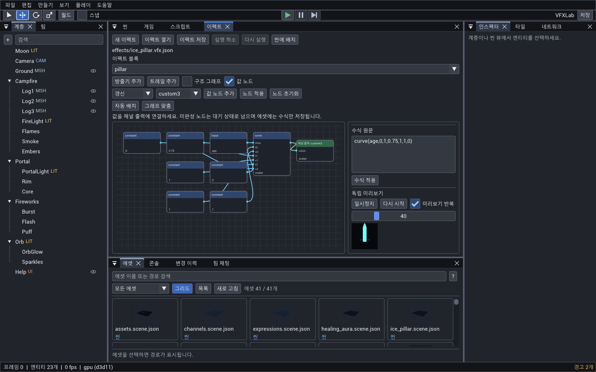
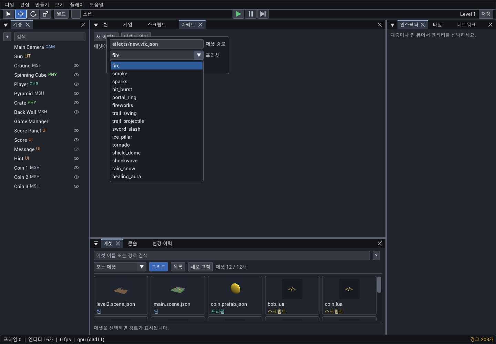

# VFX assets and headless authoring

Create, tune and verify asset-backed `VFXSystem` and direct `Trail` effects through the same command API
used by CLI, HTTP and MCP. No play session or editor window is needed. The simulation and rendering
contract remains in [PARTICLES.md](PARTICLES.md). The detailed contracts for motion channels, expressions,
value nodes and the bundled presets are in the last sections of this file.

## Portable acceptance presets

Effects > New Effect and `vfx.edit {path,new:true,preset}` offer six complete expression presets:
`ice_pillar`, `tornado`, `shield_dome`, `shockwave`, `rain_snow`, `healing_aura`.
`vfx.presets {tag:"acceptance"}` discovers them; `vfx.create {path,preset}` writes a new asset.
All meshes/textures/materials install into a versioned project directory without sample dependencies.
File conflicts are refused. Parameters and budgets are preserved. `vfx.apply_preset` attaches these six
as linked VFXSystem components with scene undo; they require replace mode. Installed files survive undo.
All 15 presets attach linked assets. The original nine support merge into unparameterized assets;
parameterized instances use named-block `vfx.set` edits or replace. See [Bundled presets](#bundled-presets).

## Motion channels and pivot

Effects can animate mesh and billboard particles without gameplay scripts. Use `positionOffset`,
`rotation3D`, `scale` and `custom0..3` for captured birth inputs, and `positionOverLife`,
`velocityOverLife`, `rotationOverLife`, `scaleOverLife`, `custom0OverLife` through `custom3OverLife`
for normalized-age curves. `vfx.schema.channels` publishes units, composition and fixed evaluation order.
Vector keys are `[[age,[x,y,z]],...]`; signed vectors are accepted, scale must be nonnegative.
Values are finite and bounded to -65504..65504; each curve has at most 16 ascending keys.

Position curves add an offset to separately integrated physics, without accumulating last frame's
curve displacement. World particles use the captured emitter frame; local particles follow their owner.
Velocity curves replace velocity before gravity, turbulence and drag every step; they are a prescribed
velocity, so gravity does not accumulate across steps while that curve is active. Removing the curve
resumes normal integration from the last velocity. XYZ rotation adds to captured `rotation3D` inside
legacy Z spin. Axis scale multiplies captured `scale`, then legacy scalar size and `meshScale` once.
Existing size/color/opacity curves retain their established behavior.

`pivot` is an unscaled geometry point fixed at the particle center. A cube's base is `[0,-0.5,0]`:
keep scalar size at 1 and animate only scale Y to grow vertically with constant width (the `ice_pillar`
preset does this). In Effects, Curves offers X/Y/Z selection and signed scalar plots, sharing document undo.
Materials read `particleCustom0..3` (glow, dissolve, ...); all four material ops also work in vertex
displacement, both renderers, and batching, without taking graph uniform slots.

`vfx.state {id,particles:true}` includes evaluated scale/rotation/custom, birth inputs,
`integratedPosition`, accepted birth `index` and immutable accepted batch `count`. Native snapshots
retain these values; scene JSON excludes them. Hot reload updates curves while preserving live birth
inputs. Rain/snow ground-height killing remains a later candidate; finite lifetime can end falling particles.
Full contract: [Motion channel contract](#motion-channel-contract).

## Typed expressions

Effects > Expressions edits Birth/Update channel text with explicit Apply/Clear and document undo.
Use `expressions:{update:{position:"vec3(cos(age*2*pi),age*2,sin(age*2*pi))"}}` to animate motion without
scripts. Birth channels capture initial values once; Update channels replace curves and preserve the
separate physics integration base. Numeric asset parameters are read as `param.name`; `targets:[]`
is valid for expression-only parameters. Scalar/vector types, own bounded math and conservative
instruction budgets keep evaluation portable and bounded. `vfx.expression_eval` checks a source with
supplied inputs; `vfx.check` reports compiled/reserved costs. `vfx.schema.expressions` lists inputs,
functions, limits and reusable snippets. The six bundled presets (`ice_pillar`, `tornado`, `shield_dome`,
`shockwave`, `rain_snow`, `healing_aura`) are complete script-free expression examples.
Full contract: [Expression contract](#expression-contract).

Effects **Value Nodes** edits individual Birth/Update channel expressions through typed nodes,
with the same document undo and validation as source editing. `vfx.expression_graph` and
`vfx.expression_source` expose the conversion for agents. Assets retain source text only;
positions stay in `.oe/` layout sidecars. See [Value nodes](#value-nodes).

## Agent recipe

Start with `vfx.schema` for reflected field names, types, defaults, ranges, options and fixed-order
module groups. `vfx.presets` lists eight texture-independent starting points with intent sentences:
`fire`, `smoke`, `sparks`, `hit_burst`, `portal_ring`, `fireworks`, `trail_swing`, `trail_projectile`.
Filter by an exact `tag`, such as `burst` or `trail`. Solid quads keep them portable. Import a soft glow/smoke texture for the desired final appearance.

Feed these JSON lines to `oe script <project>` (add `--save` to persist the scene; asset edits write immediately):

```json
{"command":"vfx.create","args":{"path":"effects/impact.vfx.json","preset":"hit_burst"}}
{"command":"entity.create","args":{"name":"Impact","components":{"Transform":{},"VFXSystem":{"asset":"effects/impact.vfx.json"}}}}
{"command":"vfx.set","args":{"path":"effects/impact.vfx.json","emitter":"hit","values":{"burst":24,"maxParticles":48,"lifetime":0.3,"startColor":"#33aaff"}}}
{"command":"vfx.check","args":{"id":"Impact"}}
{"command":"vfx.preview","args":{"id":"Impact","times":[0.1,0.2,0.4,0.6],"size":256,"out":"previews/impact.png"}}
{"command":"vfx.analyze","args":{"id":"Impact","duration":1,"render":true}}
```

Expect `peakCount:24`, `budgetRatio:0.75`, and completion shortly after 0.3 seconds. Inspect the PNG,
then patch the fields and repeat. A count of zero at time zero is expected: startup emission happens
on the first fixed step. Software PNG/hash output is identical with one or multiple render threads.

## Commands and validation

| Command | Behavior |
|---|---|
| `vfx.schema {}` | Reflection-derived fields, eight module groups (EmitterSettings is asset reflection, not a scene component), limits and the parameter/target syntax |
| `vfx.presets {tag?}` | Preset names, intent, tags and emitter/trail blocks |
| `vfx.apply_preset {id,preset,mode?}` | One undoable edit on the named entity; default `replace` attaches a fresh linked asset and resets runtime. `merge` writes a separate asset with patched preset fields, preserving unspecified authored settings; parameterized assets require replace or named-block edits. Other components and children remain intact. Adds Transform when needed. |
| `vfx.check {id|path}` | Validate the entity and its descendants; return `ok:true` plus actionable `warnings`. Invalid settings return an API error. |
| `vfx.preview {id|path,times?,size?,renderer?,camera?,motion?,out?,inline?}` | Restart an isolated copy and return a contact sheet, actual sampled times, per-tile counts/bounds/hashes and the sheet hash. PNG path when `out` is supplied; otherwise `png_base64`. |
| `vfx.analyze {id|path,duration?,step?,render?,camera?,motion?}` | Restart an isolated copy; return completion time, particle peak/time, point peak, capacity ratio, sampled counts/bounds and a metrics hash. Optional software-frame mean luminance. |

`vfx.create` and `vfx.set` strictly validate emitter asset edits; `component.add/set` validate Trail before
reflection can clamp values. Unknown fields return `unknown_field` with a nearest-name suggestion;
invalid numeric ranges return `invalid_range`; malformed or negative-size/out-of-range-opacity curves
return `invalid_curve`. Edits fail before changing any fields. Other component types retain their
existing validation. Legacy ParticleEmitter scene entries are skipped with a migration hint. Empty curves use the existing start/end values.

Warnings include zero size/opacity throughout life, no automatic births, a stopped one-shot that
cannot finish, lifetime above 30 seconds, current live count above capacity, capacity far below
rate times lifetime, missing texture, and world-space emission without a movement driver on the
owner. Movement warnings are heuristics: parent scripts or external commands can still move it.
Trail checks also explain that motion is required. Every warning includes a recovery hint.

## Preview and analysis contract

Only selected effect settings and the necessary transforms enter a separate Scene. Entity ids and
ancestor transforms are retained, preserving the existing seed mix. Live particles/points are not
copied: every request starts the effect again. Scripts, physics, other geometry, lights and camera
post-processing are not simulated. The live scene, input, frame, epoch, revision, undo, play session
and particle state remain unchanged. Textures use the existing asset cache; GPU preview may initialize
the GPU backend. Output files are restricted to the project by `Engine::ResolvePath`.

Times round to the nearest 1/60-second frame, with strictly increasing resulting frames. Default preview
times are `[0.1,0.3,0.6,1]`; time zero is before startup emission. Tiles are ordered left to right, then
top to bottom, up to four columns. Each tile is 32..512 pixels (default 256). A camera fitted to the
union of the sampled bounds is shared by every tile; empty effects use a default view. Set explicit
`camera:{eye:[0,2,8],target:[0,1,0],fov:45}` for repeatable framing across different edits. Optional
`projection:"orthographic",orthoSize:5` selects an orthographic half-height.

Bounds cover renderable particle billboards and trail geometry in world coordinates, excluding texture
alpha masks; invisible/empty effects have `bbox:null`. GPU preview is available with `renderer:"gpu"`,
but its hashes depend on hardware/driver. Software is the deterministic reference.

Analysis defaults to 5 seconds with samples every 0.25 seconds, including zero and the final frame.
Simulation always runs at 60 Hz. Peak counts and `finishedAt` examine **every fixed frame**, even between
samples. Looping emitters and emitting trails never finish; otherwise completion follows the existing
`ParticlesFinished`/trail contract. `finishedAt:null` means completion was not observed during the
requested interval, not necessarily that the effect can never finish. `budget` is the sum of emitter
capacities, and `budgetRatio` is peak particles divided by that sum. Trail points are reported separately.
The hash fingerprints returned metrics, not a serialized simulation snapshot. With `render:true`, mean
luminance is the mean normalized Rec.709 luminance of a 128x128 software frame **including the background**.

Requests are bounded: duration/time at most 60 seconds, 16 preview tiles, 241 analysis samples,
256 selected entities, 512 entities including ancestors, combined particle/point capacity at most
40000, and at most 20000000 capacity-times-fixed-steps. Preview and rendered analysis use two passes,
counted in that work bound, to share a camera without storing many full particle snapshots. Errors
suggest reducing duration or capacity. Large sample capacities can require a shorter preview.

## Trails and moving owners

An isolated preview does not execute a projectile/swing's gameplay script. Supply `motion` to simulate
the root's position explicitly: 2..32 keys `[seconds,[x,y,z]]`, increasing within 0..60 seconds.
Positions are offsets from the original root position in its parent's coordinates, interpolated
linearly and held outside the key interval. Rotation and scale stay at their authored values.
Transforms, motion and generated preview geometry must remain finite within +/-1000000 coordinates;
oversized geometry returns a range error with a shorter-duration/smaller-scale hint.

```json
{"command":"vfx.apply_preset","args":{"id":"Projectile","preset":"trail_projectile"}}
{"command":"vfx.preview","args":{"id":"Projectile","times":[0.1,0.3,0.6,1],"motion":[[0,[0,0,0]],[1,[4,1,0]]],"out":"previews/trail.png"}}
```

Without motion, a newly restarted trail is stationary and its preview has no ribbon. These motion keys
belong to the preview request, not the component or gameplay simulation.

## Reusable assets

A `*.vfx.json` groups named emitter/trail settings and intent-level parameter definitions. `VFXSystem`
links an owner to that asset; no child emitter entities are created. ParticleEmitter is an internal
settings/runtime value, not a scene component. Old ParticleEmitter files load with a removal hint and
skip that component; export them with a pre-removal build or author replacement assets. Direct Trail
components remain supported. Create a document with `vfx.create {path,vfx}`:

```json
{
  "format": "oe.vfx", "version": 1, "name": "Impact",
  "emitters": [{"name": "sparks", "emitter": {
    "loop": false, "burst": 16, "rate": 0, "lifetime": 0.4, "maxParticles": 32
  }}],
  "params": {"strength": {"default": 1, "min": 0, "max": 2,
    "doc": "Scale the impact particle count.",
    "targets": [{"to": "sparks.burst", "scale": 16}]}},
  "budget": {"maxParticles": 32}
}
```

Block and parameter names are unique ASCII letters/digits/underscore/hyphen, 1..64 characters;
block names are unique across emitters and trails. Documents allow 1..32 total blocks, 32 parameters,
32 targets per parameter, and at most 1 MiB. Settings use component reflection and omit default fields
on save. Unknown fields give nearest-name hints and their JSON location; ranges, enums and curves
are checked before any file or scene edit. Target mappings override a field, multiplying numeric
values by optional `scale`. Parameter bounds and the target field's own constraints both apply.
Targets use `blockName.fieldName`; parameter definitions and instance overrides must be objects.

Each block accepts an optional local `transform:{position,rotation,scale}`. Trails follow the owner's
world transform plus this offset; world-space particles retain their birth positions, while local-space
particles follow the block transform. `vfx.from_entity` writes a 16-number column-major affine `matrix`
instead, preserving nested/nonuniform transforms exactly. A block cannot contain both representations.
Root position is the placement, so exported offsets are relative to the selected root. Packing rejects a
singular root and ignores scripts, meshes, lights and other placement components.

| Command | Behavior |
|---|---|
| `vfx.create {path,vfx}` | Validate and atomically write the canonical document; replaces an existing asset. |
| `vfx.get {path}`, `vfx.list {}` | Read canonical asset JSON or list project-relative asset paths. |
| `vfx.set {path,emitter,values}` | Partially patch one named emitter; use `trail` for a trail. |
| `vfx.set {path,params}` | Replace parameter definitions. |
| `vfx.diff {path,against?}` | Return `{field,before,after}` changes using block names; default comparison is component defaults and identity offsets. `against` accepts another asset path. |
| `vfx.from_entity {id,path}` | Pack the selected VFXSystem/Trail subtree, preserving relative matrices, parameter defaults/targets, expression references and death links. |
| `vfx.spawn {path,name?,parent?,position?,params?,autoDestroy?}` | Create Transform + linked VFXSystem in one scene undo step. Position is parent-local; autoDestroy defaults true. |
| `vfx.state {id,particles?}` | Read effective params, playback/completion/error, aggregate counts/budget and per-block counts/emitted totals; particles:true adds detailed snapshots in each emitter block. |
| `vfx.play {id,restart?}` | Restart blocks by default, preserving parameter overrides; `restart:false` resumes emission clocks. |
| `vfx.stop {id,kill?}` | Stop automatic emission and drain particles/trail points; `kill:true` empties them immediately. |
| `vfx.burst {id,emitter?,count?}` | Manually emit one named emitter or all in asset order. Default count is each configured burst. Counts respect both caps. Manual births do not consume the startup burst. |
| `vfx.clear {id,restart?}` | Empty particles and trail points. Omitted restart retains clocks/RNG; supplied restart resets counters/clocks/RNG and rearms startup births only when true. Playback/settings are retained. Suppress autoDestroy until play/stop/burst so an empty instance can be reused. |
| `vfx.set_param {id,name,value}` | Set a validated transient parameter override. Use component.set on VFXSystem.params for a saved instance override. |

Preview/check/analyze accept exactly one `id` or `path`. Linked entity previews use authored instance
parameters and restart transient simulation; runtime controls are excluded. Preview-only motion keys
also work on assets. Asset writes have no scene undo; an open Effects document has its own history and explicit save. Runtime controls have no scene undo and leave authored
scene JSON unchanged; their parameters/playback/RNG/particles/points are copied by native snapshots.
External controls and asset writes are blocked while recording or in a network match, while deterministic
Lua gameplay can control instances. `vfx.state` never modifies the live instance.

`budget.maxParticles` is a total cap (0..40000, default 10000), in addition to each emitter's cap.
Emitters consume available capacity in asset order; overflowing births are dropped. Lowering the budget
trims later emitters first on the next step. Capacity freed by a later emitter becomes available to earlier
emitters on the following step. Index zero retains the legacy RNG seed, so an identity one-emitter asset
with the same owner id matches its plain component frame for frame. Later indices use independent fixed
seed mixes; changing block order changes these streams. No wall-clock randomness enters simulation.

Settings hot reload preserves active particles, birth snapshots, elapsed clocks, RNG and trail points when
block names/order/counts stay the same. Live curves, texture and appearance update immediately; birth
properties affect future particles. Structural changes restart all blocks. Invalid reloads keep the last
valid runtime and expose the error in state; a corrected file clears it on the next reload/step. Changing
the linked path resets transient controls after the new definition validates. Polling follows the existing
asset reload rules and is disabled during recording/network replay.

`autoDestroy` destroys the owner and its descendants only after all blocks finish. Looping emitters and
emitting trails prevent natural completion; stop them to drain. Delayed one-shots wait for startup and
expiry. A stopped, never-started one-shot warns in check. `game.pause` freezes automatic simulation and
cleanup; scripts can still call manual burst/clear while paused.

See [SCRIPTING.md](SCRIPTING.md) for the Lua bindings and [EDITOR.md](EDITOR.md) for the Effects panel.

## Shared Effects document

The native Effects panel and attached command callers use one isolated authoring document per Engine.
Standalone CLI processes each own a separate session: use `oe script` for multiple document commands,
or `--connect` to share the editor session.

| Command | Result |
|---|---|
| `vfx.edit {path,new?,preset?,discard?}` | Open a validated document; `new:true` starts an unsaved preset at a nonexistent path. Dirty switching requires save or explicit discard. |
| `vfx.edit_state {}` | Read `{open,path,document,dirty,undo,redo}`. |
| `vfx.set {path,emitter,values,merge?}` | Edit the open draft when paths resolve to the same asset; other paths still write immediately. `trail` or `params` are alternative patch modes. |
| `vfx.edit_replace {vfx,merge?}` | Validate/replace the full draft, including block structure, budget and transforms. |
| `vfx.undo {}`, `vfx.redo {}` | Move through up to 64 document edits. Consecutive equal nonempty merge keys coalesce dragging. |
| `vfx.save {}` | Atomically save after checking that the original disk text has not changed; external changes return `asset_changed`. |
| `vfx.close {discard?}` | Close; dirty documents require explicit discard or save. |

`vfx.get`, `vfx.check`, `vfx.diff`, `vfx.preview` and `vfx.analyze` read the draft when the path is open,
including a new path that has not been saved. Preview captures definitions at request start and never
reloads them mid-simulation. Scene instances use saved assets until explicit save and normal asset hot
reload; source draft edits do not create scene history or change the scene's dirty flag. `vfx.create`
and `vfx.from_entity` refuse to overwrite the currently open asset. Document changes use the engine's
revision notification, so attached callers and the UI see the same validated values. Document commands
are blocked during recording/network matches, like external VFX asset edits.

The UI groups fields and exposes curves, gradients, isolated playback and scene placement.
See [EDITOR.md](EDITOR.md) for controls and screenshot flags.

## Materials, mesh particles, ribbons and death chains

Emitter `material` and `Trail.material` bind ordinary `.mat.json` assets, including graphs authored
in Shaders. Particle materials use the emitter's texture when specified, otherwise the material's own
base texture. Trail fades multiply the explicit trail image or the material's base texture. Materials can
be lit (`unlit:false`); effects still cast no shadows. Missing materials/meshes are magenta at runtime;
`vfx.check` reports broken material dependencies and missing/animated/oversized meshes.

Three zero-argument graph operations are available in both vertex and fragment stages: `particleAge`
(normalized age in 0..1), `particleRandom` (stable birth value in [0,1)) and `particleSpeed` (world meters
per second). Outside particles they are zero; ribbons supply normalized point age and zero random/speed.
Batched effects use vertex attributes; unbatched effects use a dedicated draw input with shared meshes.
Neither consumes named graph uniforms, so all eight slots remain available. Random
uses `hash = randomState XOR uint32(emitted + birthIndex)` after legacy birth draws, then xor-shift 16,
multiply 0x7feb352d, xor-shift 15, multiply 0x846ca68b, xor-shift 16; upper 24 bits / 16777216.
It does not consume another PRNG draw. Native snapshots retain this value and death-chain depth.

Set `mesh` to a static project mesh or a built-in name (`crescent` is included), and `meshScale` to XYZ
scale. Lifetime size multiplies this scale; emitter orientation and particle rotation/spin orient the
mesh. World-space mesh particles capture emitter orientation at birth. Skinning/animation is excluded.
The authoring limits are 65536 vertices and 196608 indices per source mesh and 1000000 source vertices
multiplied by `maxParticles` per emitter. Runtime gathering also guards the live geometry budget.

`batching:true` combines an emitter into a single mesh/draw with per-vertex color, opacity, age, random
and speed. Particles sort internally back to front, but each emitter sorts as a whole relative to other
transparent objects. Leave it false when overlapping transparent objects must interleave. Legacy
billboards and their reference hashes keep their original per-particle draw path. Multi-material meshes
without an explicit material override retain separate particle draws. Batching reduces draw submission,
but rebuilding a CPU mesh costs more than collecting shared quads; it is not a universal CPU speedup.

A `Trail` with `mode:"ribbon"` sweeps a surface from `baseOffset` to `tipOffset` in owner/block coordinates.
Optional `baseAnchor` and `tipAnchor` identify unique scene entity names; offsets then use those entity
coordinates. Missing or ambiguous names suppress new samples and produce a checker hint. Both endpoints
are sampled, so a stationary blade base with a moving tip still leaves a ribbon. Camera rotation does
not change the swept geometry. `duration` limits emission, then existing points drain for `lifetime`;
zero keeps the old indefinite emission. `trail.state {points:true}` includes each ribbon point's `tip`.
Isolated path/editor previews use local offsets; named external anchors belong to scene instances.
Entity previews copy referenced anchor transforms without running their scripts.

Within a `.vfx.json`, set an emitter's `onDeath` to another emitter's name and `deathCount` to 0..256.
Death bursts are dispatched after every emitter has stepped, in source block/particle order, at the
expired particle's world position. Newborns start at age zero regardless of target block order. The
target's settings/orientation are used, but these births are always world-space. A target with
`playing:false` receives explicit death bursts without automatic emission. All births obey the target
cap and the shared system budget. Cycles are allowed but stop after generation depth 4. Stopping the
system also suppresses death births while it drains. This link is asset-only; standalone components
must be packed with `vfx.from_entity` to form a shared system.

`sword_slash` is the ninth preset: a two-anchor ribbon, mesh crescent and sparks. Multi-emitter presets
use the first emitter on the requested entity and reuse/create named child entities for later layers.
Use `vfx.preview` with motion keys, as with trails.

Screen-space distortion/refraction is not implemented: surface graphs cannot sample the scene color,
and the software surface sampler only exposes the base texture. The GPU composite samples the scene
for postprocessing, but has no particle distortion pass. Soft/depth-faded particles remain optional
future work. Effects also provides the structure graph described below.

## Effects structure graph

The Effects panel has one toolbar row (new, open, save with a `*` while unsaved, undo/redo, Place in Scene, the
file) and one row with the block being edited, Add Emitter / Add Trail and the three views **Fields**,
**Structure Graph** and **Value Nodes** (pressing the lit one again returns to Fields). In Fields a row of chips
chooses the group (Emission, Shape, Motion, ...), every field is a row with its label on the left (its description
is the label's tooltip, a plug icon marks a field a parameter controls) and curves and expressions take the whole
width under their label. The preview beside it has play/restart, a timeline, the particle budget as a bar that
turns amber and red as it fills, a ground grid and a dark / mid / light background (dark smoke and bright sparks
need different ones).

Open a `.vfx.json` in Effects and choose **Structure Graph**.

The graph is where an effect is built, in the way of Unity's VFX Graph: an emitter is one tall node, a stack of
the four stages of a particle's life, and its fields are edited in the node.

| Context | What it holds (the engine's field groups) |
|---|---|
| **Spawn** (green) | Emission (rate, burst, budget), Timing (lifetime, loop, delay) |
| **Initialize** (blue) | Shape, Appearance (sizes, colors, rotation), birth expressions |
| **Update** (amber) | Motion, Curves, update expressions |
| **Output** (purple) | Render (material, mesh, texture, blend, flipbook) |

- A context's band folds it away. Under it each group has a line with how many of its fields are listed
  (`3 / 6`); a group lists the fields the effect sets, those a parameter drives and the few nearly every effect
  tunes, and clicking the line lists all of them (again: only those in use). Folded contexts and the positions of
  the nodes are layout (`.oe/vfx-layout/`), never part of the asset.
- A field is a row: a pin, its name and its value, edited in place through `vfx.set` (curves say how many keys
  they have and are edited in the panel on the right). Zoomed far out the rows show the values as text.
- Parameters are nodes at the left. Drag a parameter's output to a field's pin to make it drive the field;
  right-click the pin to disconnect. Right-click a field for **Make Parameter** (a new parameter with the field's
  value, already connected) and **Reset to Default**. An emitter's output dragged to another emitter's **Trigger**
  makes that one burst where its particles die (`onDeath`). Material and anchor reference nodes connect to the
  `material` and anchor fields. The **System** node holds the particle budget.
- **Values as nodes, on the same canvas.** Initialize and Update end with the values an expression computes
  (position, velocity, size, color, `custom0..3`, ...). Clicking one puts its value nodes on the canvas, wired
  into that row; the panel on the right then has Add Value Node, Apply Nodes, Reset Nodes, the selected node's
  settings and the expression's text. Dropping a node's output on the row's pin makes it the value. The asset
  still stores only the expression text. Clicking the row again hides the nodes; right-click it to remove the
  expression. (The separate **Value Nodes** view shows the same nodes alone.)
- The preview and the fields of the chosen block stay at the right of the canvas.
- A graph that would be too small to read when fitted opens at 80 % on its top instead; emitters are tall, so
  fold the contexts not being worked on.

`oe editor <project> --effects effects/x.vfx.json --effects-graph [--effects-values] --screenshot f.png` renders
it headless (with `--effects-values` the update `size` value's nodes are on the canvas). Automation finds rows
through `NativeEditor::EffectsControlRect`: `node:<id>`, `context:<id>:<Context>`, `module:<id>:<Group>`,
`input:<id>:<field>`, `gfield:<id>:<field>`, `expression:<id>:<stage>:<channel>`, `value-node:<i>`,
`value-out:<i>`.
This is a view of the existing asset document: every node, row and wire is something the `.vfx.json` already
says, and a per-particle value is still an expression.

- Add Emitter / Add Trail create document blocks. **Parameter for <field>** (the field clicked in the graph)
  creates a typed default and its first target. Parameter definitions, names and target scales remain
  editable in the inspector; existing scales are preserved when adding a wire.
- Drag a Material output onto `material`; double-click the Material card to open its material and
  source graph in Shaders. Material Reference adds an existing project material to the palette.
- Drag an Emitter output onto another emitter's `trigger` to set the source's `onDeath`. The source
  has one death target; the target can receive several sources. `deathCount` stays a component field.
- Anchor Reference lists unique scene names with Transform. Connect an Anchor to a Trail's
  `baseAnchor` / `tipAnchor`. These are scene references; the isolated preview uses local offsets.
- Drag a Param output onto a component field. The command validator rejects missing fields, wrong
  types and invalid ranges without changing the draft. Controlled fields reject direct reference
  wires until their parameter target is disconnected. Refused wires outline the target card and show
  the command hint (also on hover).
- Right-click an input to disconnect. A trigger input removes all incoming death references;
  disconnecting a parameter's final target removes its definition, because assets forbid orphans.
  Undo restores the document and those references. Output edits the shared `maxParticles` budget.
- Drag the header to move a node; drag the empty canvas (or middle-drag) to move the view; the wheel zooms.
  Auto Arrange resets positions; Fit Graph frames every card. The normal field view retains the full preview
  controls; the graph keeps a compact independent preview alongside it.

Every document edit uses `vfx.edit_replace` or `vfx.set`, sharing draft validation, attached-agent
updates and document undo/redo/save. Node positions, pan/zoom and unused palette references are stored
atomically in `.oe/vfx-layout/<asset-path-hash>.json`, with the asset path checked on load. Positions
are keyed by block/parameter name or reference path. Missing layouts use automatic positions; invalid
layouts report a notice and fall back. Layout edits never dirty the asset or change `vfx.diff`.
The shared `EditorNodeCanvas` owns only pan/zoom, card dragging, pin hit areas and wire drawing;
shader and effect documents retain their own semantics.

For an automated screenshot:

```text
oe editor <project> --effects effects/x.vfx.json --effects-graph --frames 20 --screenshot build/effects-graph.png
```

## Motion channel contract

- Birth captures offset position, velocity, XYZ rotation, axis scale and four custom values alongside
  existing size, color, opacity and stable random. Runtime `index` is the emitter's accepted birth order;
  `count` is that call's accepted batch size, captured immutably. Clearing resets the birth index.
- Existing particles step before new births. Each update advances age, optionally replaces velocity
  from its curve, applies gravity/turbulence/drag, integrates a separate position, then evaluates
  offset position, rotation, scale and custom curves, expires particles and performs emission.
- Position curve is an additive displacement from separately integrated motion. It never modifies
  that integration base. A removed curve removes its displacement on the next step. Velocity curve
  is a prescribed velocity in emitter meters/second, replaced before forces each step; gravity does
  not accumulate across steps with this curve enabled. Empty velocity curves keep normal integration.
- World motion curves transform by the emitter matrix captured at birth; moving/rotating the owner
  later leaves that frame intact. Local particles use local values and follow their current owner.
  Rotation is extra XYZ Euler degrees inside legacy Z rotation/spin, in billboard or mesh axes.
- Axis scale is birth `scale` multiplied by `scaleOverLife`; scalar lifetime size and meshScale apply
  once. Geometry translates by negative `pivot` before scaling/rotation, fixing that point at its
  particle center. Default transforms bypass the new matrix path and preserve legacy frame hashes.
- Vector curves are `[[age,[x,y,z]],...]`, at most 16 keys, nondecreasing age within 0..1, linear
  interpolation and endpoint clamp. Position/velocity/rotation are signed, scale is nonnegative.
  Birth vectors and custom values/curves are finite within -65504..65504. New fields default to zero,
  unit scale and empty curves. Existing scalar size/color/opacity rules remain unchanged.
- `custom0..3` are captured values replaced by their signed scalar lifetime curves. Dedicated vertex
  attributes carry them to materials; shared unbatched meshes use dedicated per-draw inputs as with
  particleAge/Random/Speed. They consume no authored graph uniform slots. `particleCustom0..3`
  are zero-argument graph operations available in both vertex and fragment stages. Ordinary meshes
  and ribbons default to zero. Batching preserves one custom vector for every particle's vertices.
- Native snapshots and rollback clone captured/evaluated values, integration base, accepted counters,
  random stream and clocks. Scene JSON excludes transient state. Hot reload preserves live birth
  values while replacing curves; a rejected asset edit leaves the valid runtime unchanged.
- `vfx.schema.channels`, reflected docs and `vfx.state {id,particles:true}` expose the contract.
  Effects fields and graph modules edit the shared draft; vector axes share one set of age keys.
  Moving/adding a key resamples its other axes; removing a key removes it across axes.

## Expression contract

Only source text is serialized, under the emitter's `expressions`:

```json
{
  "birth": {"position": "vec3(index,0,0)", "custom0": "random"},
  "update": {
    "position": "vec3(cos(age*2*pi),age*param.height,sin(age*2*pi))",
    "scale": "vec3(1,1-pow(1-age,3),1)",
    "opacity": "curve(age,0,0,0.1,1,0.8,1,1,0)"
  }
}
```

- Position, velocity, rotation, scale and color require `vec3`; size, opacity and custom0..3 require
  scalars. Arithmetic broadcasts scalars to vectors; comparisons require scalars. Ordinary decimal
  literals (including `.5`), unary +/-, parentheses and + - * / < <= > >= == != are supported.
  Scientific literals, assignments, loops, strings, user functions and recursion are not supported.
- Functions: vec3, min, max, abs, clamp, lerp, select, sin, cos, pow, exp, sqrt, floor, fract, dot,
  length, curve. `select(condition,a,b)` evaluates both branches. `curve(t,t0,value0,...)` has 1..16
  ascending literal ages in 0..1, same-type values, linear interpolation and endpoint clamping.
- Inputs: normalized age, lifetime in seconds, emitterTime, systemTime, accepted index/batch count,
  stable random, speed, birthPosition/Velocity/Rotation/Scale/Color, birthSize, birthOpacity and pi.
  Vector inputs and vector parameters support `.x/.y/.z`; arbitrary expression postfix swizzles do not.
  `param.name` reads asset numeric scalar/vec3 parameters; expression names use identifier characters
  (ASCII letters, digits and underscores). Hyphenated legacy parameter names remain valid for field mappings.
- All Birth channels read one frozen pre-expression context. Position/velocity replace shape/offset
  position and initial velocity in emitter coordinates. Rotation/scale replace captured XYZ birth
  values. Color/size/opacity replace start/end values. Custom channels replace captured custom values.
  Outputs are then recaptured for Update; Birth never runs again on live particles after a parameter edit.
- Update channels read one frozen context after age advances, before prescribed velocity/forces.
  Newborns also evaluate Update at age zero. Update position is an offset on separately integrated
  motion, rotation adds to captured XYZ rotation, scale multiplies captured scale, velocity replaces
  velocity before gravity/turbulence/drag. Color/size/opacity/custom replace the corresponding curve
  output. Missing expressions use existing curves and fields; legacy Z spin still applies.
- Position/velocity vectors use emitter coordinates. World particles transform them by their captured
  birth frame; local particles follow the owner. Speed is the magnitude of stored particle velocity,
  before this step's Update velocity/forces (local-space speed for local particles). Birth size excludes
  the captured sizeVariation multiplier; Birth and Update size each apply that multiplier exactly once.
  Scale/size clamp nonnegative; opacity clamps 0..1. RGB and custom data allow signed/HDR values within
  the finite instruction range. Standard material/color handling applies at rendering.
- emitterTime follows the existing emitter emission clock; stopped emission freezes that clock.
  systemTime is the parent VFXSystem clock sampled at step start, including during stopped emission
  while particles age. Standalone emitters use emitterTime. Newborns see the emission clock at birth.
  Pause freezes simulation clocks; clear does not reset them. Asset restart/new system resets them.
- Cached immutable programs are internal, shared by native snapshots; current parameters and clocks
  remain runtime values. Hot reload preserves captured birth values and replaces Update programs.
  Scene JSON stores source only, not instructions/caches/particle state.

`vfx.schema.expressions` publishes functions, inputs, limits and orbit, spiral, pulse, ease-out,
rise/hold/fall and random-range snippets. `vfx.expression_eval {source,type?,inputs?,params?}` is a
read-only diagnostic returning typed value and instruction count. `vfx.check` reports
expressionInstructions and expressionStepInstructions. Errors identify block, stage/channel and
line/column, with repair hints; rejected edits leave the valid draft and runtime untouched.

### Numeric and cost bounds

Each source has at most 1024 bytes, nesting 32 and 64 instructions; the sum is at most 256 per emitter
and 512 per asset. Capacity reserves `sum(maxParticles * 5 * (birthCost + updateCost)) <= 1000000`
instructions per step, conservatively covering initial Update evaluation and death-birth passes.
This uses configured capacities, even when the global particle budget is lower. Command preview/analysis
add a request bound of 100000000 reserved instructions across frames and passes; editor scrubbing uses
the same bound. Existing particle-step and capacity limits still apply. Costs count compiled operations,
not wall-clock time; all math functions have bounded internal work.

Every instruction clamps to +/-65504. Division by zero, negative square root and negative fractional
power return zero; NaN and subnormals become zero. `0^0` is 1, other zero-base powers are zero. Own
float polynomial/Newton math avoids platform transcendental libraries and uses the engine's disabled
floating-point contraction. exp below -20 returns zero and above 11.1 saturates. These are bounded
visual approximations, not scientific math. Tests check sin absolute error below 0.0005 over 0..2*pi,
pow below 0.00002 for bases 0.1..1.1/exponent 2.3, exp below 0.0001 for -4..4. Large angles lose normal
single-precision resolution. Keep phase inputs small with fract when appropriate.

## Value nodes

Value nodes are an authoring view of the bounded expression compiler, not another evaluator. The effect
document retains expression text only; node positions live in project `.oe/` sidecars. Edits compile back
into source and use the shared VFX document commands and history. Unsupported conversions and invalid
connections preserve the source document.

Open a `.vfx.json` in Effects, enable **Value Nodes**, then choose its emitter, Birth/Update stage
and channel. **Structure Graph** remains the block/reference view; Shaders remains the material editor.
An unassigned channel displays a starter graph and keeps authored values until nodes are applied.

- Drag a header to move its card. Middle mouse pans, wheel zooms; Fit Graph and Auto Arrange reset framing.
  Header/body text scales with canvas zoom; the selected node's properties remain full size.
- Add Value Node offers constants, particle inputs, parameters, scalar/vector math, vec3, component
  reads and curves. Select a node for its literal/input/axis and indexed argument controls.
- Connect output pins to argument pins or the green channel output. Right-click an input to disconnect.
  Complete, valid edits apply through `vfx.edit_replace`; malformed or incomplete topology stays
  pending with an error and does not alter the shared source document. Reset Nodes discards pending topology.
- Literal text accepts unsigned decimals or `pi`; Negate represents negative values. Numeric dragging
  coalesces into one document undo step per drag. Enter commits a literal edit. Remove Node deletes
  a node and leaves affected inputs pending until reconnected.
- Curve inputs are time followed by ascending constant age/value pairs. Add/Remove Key edits its
  argument pairs; wire constant ages and scalar/vector values, matching the expression language.
- Apply Nodes explicitly validates and commits the current graph. Source text can also be edited and
  applied in the same view. Undo/Redo and remote `vfx.set` edits refresh nodes from the shared document.
  Scalar/vector parameter type changes refresh compiler-derived node types. String/bool parameters
  continue working in the effect document and are excluded from expression parameter pickers.
- Save Effect saves the last validated source document. Incomplete pending topology is transient and
  is not saved. Positions, pan and zoom live in `.oe/vfx-layout/`; moving nodes does not dirty the asset
  or create document history. Layouts use block/stage/channel/compiler-index keys; after structural
  text edits, Auto Arrange can reframe retained positions.

```text
oe editor <project> --effects effects/ice_pillar.vfx.json --effects-values
```

With the `ice_pillar` preset the screenshot flag selects Update custom3, showing the dissolve curve. Other channels are
selected through the toolbar. Enable Value Nodes interactively to edit any emitter/channel.



### Value-node commands

`vfx.schema.expressions.valueGraph` describes operations, inputs and limits. Read-only conversions:

```json
{"command":"vfx.expression_graph","args":{"source":"age*2","type":"scalar"}}
{"command":"vfx.expression_source","args":{"type":"scalar","graph":{"format":"oe.vfx.expression_graph","version":1,"nodes":[{"op":"input","name":"age","args":[]},{"op":"constant","literal":"2","args":[]},{"op":"multiply","args":[0,1]}],"output":2}}}
```

Both return `source`, a compiler-derived typed `graph`, output `type` and compiled instruction count.
Export also returns `nodeTypes` in the supplied graph's node order, including disconnected nodes.
Graph nodes have `op`, integer `args`, plus `literal`, `name` or `axis` where applicable; `type` from
conversion is advisory metadata, never trusted as a type declaration. Parameters use an optional
`params` object of at most 32 numeric scalar/three-vector defaults. Node and output indices refer to
this transient node array, with zero-based X/Y/Z axis indices for component reads.

Graphs allow 1..64 nodes, depth at most 32. References, cycles and arities are checked, including
unreachable nodes, then every node and the channel output are compiled by the runtime compiler.
Sharing nodes expands to expression text; the resulting 1024-byte/64-instruction/depth limits still
apply, and full-document replacement additionally checks emitter/effect/step budgets. No graph
instructions bypass those limits and there is no graph interpreter in the editor.

Numeric literal spelling, including tiny decimals and `pi`, is captured during compilation so
conversion cannot introduce decimal-rounding drift. Recompiled operations, types, arguments,
values and names must match exactly before a text conversion is accepted. Text layout/whitespace
can normalize when a node edit is applied; layout-only changes do not rewrite source.

Component reads require a named vector input or parameter, matching the current text grammar.
The serializer uses explicit parentheses; valid text whose canonical expansion exceeds source/depth
limits is refused with `unsupported_expression_graph`. Keep it in text view. Invalid graph fields,
cycles, missing references, wrong types or budgets are rejected with a hint. Conversion commands
never mutate the scene or isolated draft: an agent applies returned source through existing `vfx.set`
or `vfx.edit_replace`, then uses the shared undo/save flow. No typed tree or bytecode goes into assets.

## Bundled presets

The six script-free expression effects are built-in presets: a fresh project can create them, and the
executable installs their meshes, textures and surface materials. There are 15 presets in total;
`vfx.presets {"tag":"acceptance"}` lists these six.

Open **View > Effects**, click **New Effect**, choose a preset and a new `.vfx.json` path, then **Create**.
The complete effect opens as an unsaved draft. **Save Effect** writes it; **Place in Scene** creates a
linked `VFXSystem`. **Structure Graph** shows blocks/references; **Value Nodes** edits the selected
Birth/Update expression. Source, nodes, agents and document undo share the same validated draft.
Preset intent appears on hover; the expanded selector shows all 15 choices on a normal-height window.

| Preset | Controls | System particle budget |
|---|---|---:|
| `ice_pillar` | Base-pivot growth, frost and fragments | 45 |
| `tornado` | `height`, `rise` | 128 |
| `shield_dome` | `radius`, rim pulse and fade | 1 |
| `shockwave` | `speed`, radial growth and dissolve | 1 |
| `rain_snow` | World-space rainfall and drifting snow | 88 |
| `healing_aura` | `radius`, `height` | 48 |



### Through commands

```json
{"command":"vfx.create","args":{"path":"effects/ice.vfx.json","preset":"ice_pillar"}}
{"command":"vfx.check","args":{"path":"effects/ice.vfx.json"}}
{"command":"vfx.preview","args":{"path":"effects/ice.vfx.json","times":[0.15,0.75,2.4,3.1],"size":128,"out":"build/ice.png"}}
{"command":"vfx.spawn","args":{"path":"effects/ice.vfx.json","position":[0,0,0]}}
```

`vfx.create` accepts exactly one of `vfx` or `preset`. Explicit documents retain the previous file
write behavior; the preset route refuses an existing destination with `already_exists`.
`vfx.edit {path,new:true,preset}` creates a shared draft without writing the effect file.
Numeric parameter definitions, defaults, ranges and total system budgets survive both routes.

`vfx.apply_preset {id,preset}` attaches the six bundled presets as a `VFXSystem`, removing direct
ParticleEmitter/Trail components on that owner. It is one scene undo step. Other child entities remain.
Bundled presets require `mode:"replace"`; `merge` is rejected before installation. The original nine
presets keep their direct-component replace/merge behavior. A direct preset replacement removes an
existing VFXSystem on the owner, avoiding two effects there at once.

### Installation and ownership

The manifest `engine/app/vfx-presets/files.cmake` lists the six assets and their dependency files, whose
sources live next to it in `engine/app/vfx-presets/` (effects, meshes, textures, materials and graphs).
CMake normalizes JSON newlines and snapshots binary bytes; changing an embedded file rebuilds the generated
source. No runtime file lookup occurs.

References are remapped into `assets/vfx-presets/<bundle-hash>/`, retaining relative source paths
inside that directory. Only reachable dependencies are installed, with transitive material/shader
references. Identical files are reused. All destination conflicts are checked before installation;
modified files produce `preset_conflict`, never an overwrite. A new bundle uses a new hash directory.
The hash is a version namespace, not a security signature.

Dependencies belong to the project and are included by normal packaging. Scene undo and draft discard
retain these files, just like other authored assets. A failed disk write may leave unused dependencies,
but does not publish a partially validated effect or change scene/document history. To customize the
bundled linked asset, create a named copy with `vfx.create` and edit it with `vfx.set`/Effects; edits to
shared installed dependencies intentionally prevent later automatic reuse until restored.

### Release limits

- CPU simulation, fixed 60 Hz; no GPU compute backend, particle physics collision, terrain sampling,
  soft particles or screen refraction/distortion.
- Rain/snow expire at a floor relative to their captured spawn frame, using fixed lifetime and velocity.
  There is no height-kill channel or terrain collision. Moving the owner retains world-space particles.
- Expression source is the serialized authority. 1024 bytes/channel, depth 32, 64 instructions/channel,
  256/emitter, 512/asset and 1,000,000 reserved expression instructions/step; over-budget authoring fails.
  Request simulation cost is bounded separately. Values saturate to finite +/-65504; NaN becomes zero.
- Value nodes are a bounded view of expressions, not a free execution graph. Conversion can be refused
  for unsupported/deep source while preserving the document. Simulation order remains fixed.
- Static mesh particles and shader/custom channels are supported. Arbitrary skeletal mesh particles,
  GPU sorting and GPU simulation remain future work. Transparent renderer comparisons are approximate.

## Single particle authoring route

ParticleEmitter is internal settings/runtime only: it is not a scene component, and old scene entries load
with a VFXSystem migration hint (that component is skipped, the rest of the entity stays). Standalone
`particles.*` commands, the Lua `particles` table and `self:burst` are removed; author `.vfx.json` blocks and
attach `VFXSystem`. Direct `Trail` components remain. `VfxSeedMix(index) = uint32(index) * 0x27d4eb2d`; index
0 is exactly zero, so a one-emitter asset reproduces the old standalone RNG stream for the same owner id.
`vfx.from_entity` packs linked assets and direct trails, renaming parameters, expression references and
death links, keeping relative matrices and authored overrides as defaults. DESIGN.md invariant 1.8 covers
such approved pre-release consolidations.

## Open items

- Linux/EGL, browser WebGL2 and Android device execution of material/mesh/expression effects.
- Direct `Trail` retirement (keep it or fold it into assets) is undecided.
- Ground-height kill for rain/snow, soft particles, screen distortion, GPU simulation and sorting.
