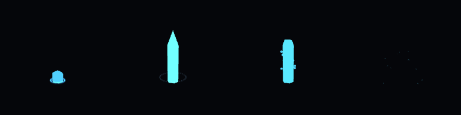
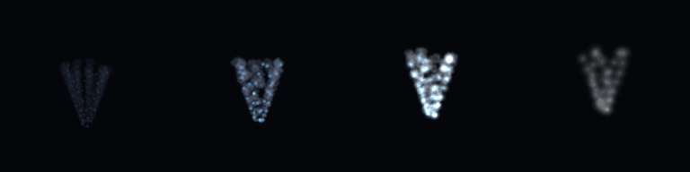
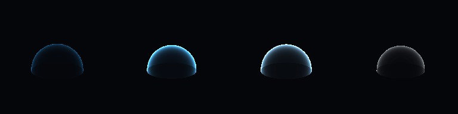
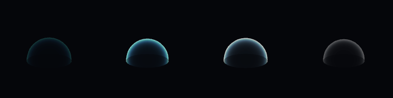
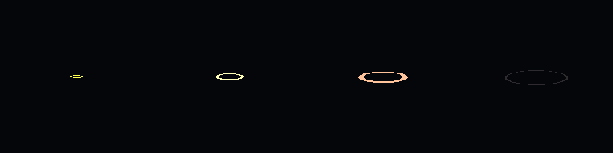
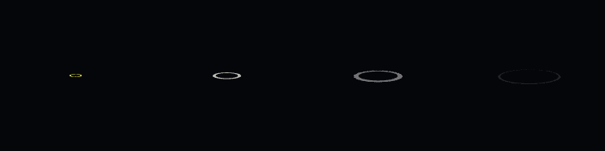
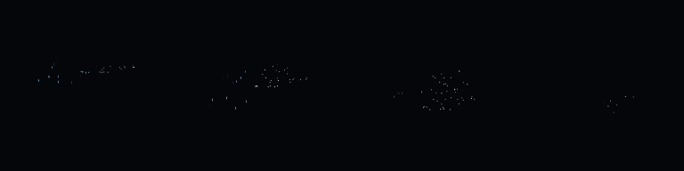
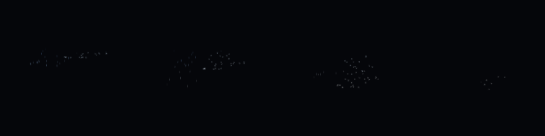
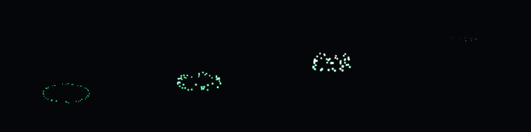
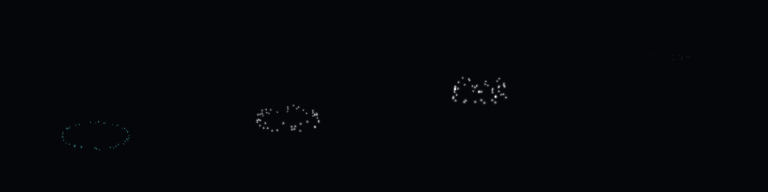

# VFX phase 5b+: text-only effect acceptance gate

Six effects prove the existing Birth/Update expression channels before value-node editing begins.
All visuals come from `.vfx.json`, generated mesh geometry and surface shader graphs. The matching
scenes contain a camera, one linked VFXSystem and a ground mesh, with no Script components.
Presets and release polish remain phase 5d.

## Opening the effects

Run `oe editor samples/VFXLab`. Double-click an asset under `effects/`, or load its matching
`scenes/<name>.scene.json` and press Play. Effects > Expressions edits the source channels;
Structure Graph shows blocks and references. Mathematical value nodes remain phase 5c.

```text
oe editor samples/VFXLab --effects effects/ice_pillar.vfx.json --effects-graph
python samples/VFXLab/tools/make_acceptance.py
```

The generator regenerates all six assets/scenes, three procedural GLB meshes and three materials.
It reuses the existing glow/smoke textures and ice material. No external art tools are needed.

## Effect contracts

| Asset / matching scene | Behavior |
|---|---|
| `ice_pillar` | Base-pivot crystal grows only in Y, holds, dissolves through custom3; frost and fragments are separate blocks. |
| `tornado` | Immutable index/count distribute captured birth heights; age drives orbit and rise. |
| `shield_dome` | Hemisphere pulses uniformly; shader fresnel brightens its rim, custom0 pulses glow and custom3 fades alpha. |
| `shockwave` | Mesh radius expands at speed in metres/second; UV-based custom3 dissolve and opacity end the ring. |
| `rain_snow` | Wide box births, captured world frame and constant vertical fall; snow has sideways wobble. |
| `healing_aura` | Age-driven rising spiral, varied lifetime spreads visible heights; stable random and custom0 drive glow. |

Rain/snow deliberately use the previously deferred lifetime workaround: birth height is 3 metres
above the emitter, and vertical speed is -3/lifetime. Centers reach the spawn-relative floor as
their lifetime expires. This is not a height-query/kill-plane feature, and particles do not collide
with slopes or changing ground. Moving an emitter preserves older world particles and sets the
floor for newly born particles. `vfx.check` reports two intentional `stationary_world_space`
advisories, one for each weather block; these are not validation errors.

## Recorded verification

[Full check, preview and analysis JSON](VFX_PHASE5B_PLUS_RESULTS.json) records each frame hash,
count, bounds, completion and compiled/reserved costs. Contact sheets use 192px tiles and the times
in that file. Analysis runs for 5 seconds with 0.5-second samples. Reserved costs are conservative
operation counts per fixed step, not timing measurements.

| Effect | Compiled instructions | Reserved/step | Peak / budget | Finish (s) | Software contact-sheet hash |
|---|---:|---:|---:|---:|---|
| ice_pillar | 163 | 13185 | 33 / 45 | 3.38333333 | `02b95423f7c86736` |
| tornado | 136 | 46720 | 128 / 128 | 4.03333333 | `3e32ccc78664821e` |
| shield_dome | 37 | 185 | 1 / 1 | 3.03333333 | `9a4eae825d7e99cd` |
| shockwave | 31 | 155 | 1 / 1 | 1.43333333 | `04864a5d06b57244` |
| rain_snow | 66 | 15120 | 60 / 88 | 4.31666667 | `03702d310763eb04` |
| healing_aura | 90 | 21600 | 48 / 48 | 2.96666667 | `3b65781a0e97402d` |

The three acceptance tests verify repeated preview hashes, script-free scenes, peak/finish bounds,
native restore and future rendered hashes for all six effects. Motion/material assertions check
ice base and width, tornado index/radius/rise, uniform dome scale, rim alpha and fade, shockwave
speed/dissolve, moving-world weather floors, and spiral glow. The 128px test hashes are shared
between Windows and Node/WASM. Legacy tests remain in the full suite.

Render comparison isolates effects at 128x128 after 60 steps, with eye (4,3,7) aimed at (0,1.5,0).
Mean absolute RGB differences use 8-bit channels. Software vs D3D11 tolerance is 2.0/255
(under 0.8%); individual vs batched software tolerance is 0.5/255. Translucent emitter groups
sort independently, so tornado batching is approximate. These bounds do not imply pixel equality.

| Effect | Individual software / D3D11 | Batched software / D3D11 | Software batching |
|---|---:|---:|---:|
| ice_pillar | 0.533 | 0.532 | 0.001 |
| tornado | 0.403 | 0.368 | 0.311 |
| shield_dome | 0.557 | 0.557 | 0.000 |
| shockwave | 1.534 | 1.534 | 0.000 |
| rain_snow | 0.288 | 0.288 | 0.000 |
| healing_aura | 0.923 | 0.923 | 0.000 |

The ring is the largest software/GPU difference; edge coverage and material output are approximate
at this resolution. Both previews were inspected. Six real CLI scene.load -> sim.step ->
render.screenshot flows and the Korean Effects structure-graph screenshot were also inspected.
No engine/player implementation changed in this milestone, so the phase 5b prebuilt players remain
current. Android devices, browser GPU and Linux/EGL execution remain unverified.

## Contact sheets

| Effect | Software | D3D11 |
|---|---|---|
| ice_pillar |  |  |
| tornado |  |  |
| shield_dome |  |  |
| shockwave |  |  |
| rain_snow |  |  |
| healing_aura |  |  |

## Implementation status (work log)

- [x] Ice pillar growth/hold/dissolve, frost and fragments; base and width checks.
- [x] Tornado index placement, orbit and rising particles.
- [x] Shield dome scale pulse, fresnel and shader-input fade.
- [x] Shockwave mesh expansion, outward speed and dissolve.
- [x] Rain/snow box births, world space and constant fall; finite lifetime ends at the spawn-relative floor.
- [x] Healing spiral with custom data driving material glow.
- [x] Per-effect check, repeated preview, analysis and recorded bounds/finish/costs.
- [x] Windows Release: all 296 tests pass; no new C++ warnings.
- [x] Node/WASM: all 242 tests pass, including all six identical 128px preview hashes.
      The existing unused ProcessFixtureDir warning remains.
- [x] Software/D3D11 comparisons, batching and native restore.
- [x] Editor screenshot and six script-free scene verification flows.
- [ ] Device/browser GPU/Linux execution: run all six scenes and rendering suite on those targets.
- [x] Phase 5c value-node authoring: [VFX_PHASE5C.md](VFX_PHASE5C.md).
- [ ] Phase 5d presets/release.
